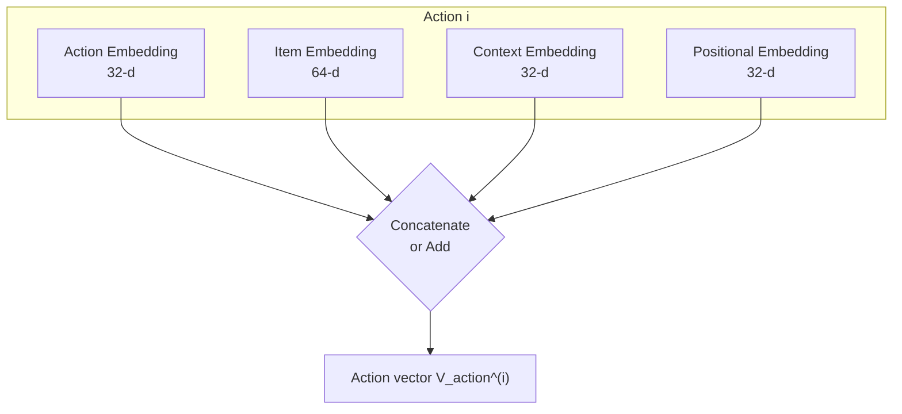
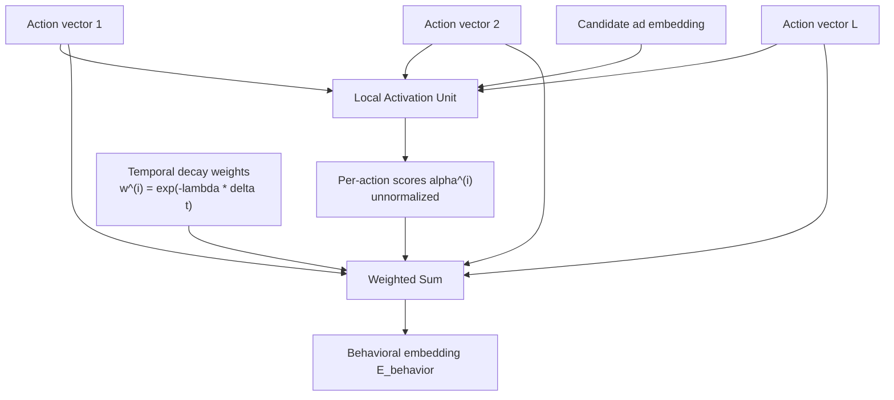

# Appendix 2: Embedding Architectures for Sequential Features

**Related Chapter:** [Chapter 6: Multi-Tower Scoring Model for CTR/CVR Prediction](ch6_multi_tower_scoring_model.md)

This appendix provides technical foundations for embedding-based feature encoding used in Chapter 6's multi-tower scoring model. We progress from basic token embeddings to advanced sequential encoders for text and temporal behavioral data, covering the architectures needed for production ad ranking systems operating under strict latency constraints.

---
<details>
<summary>Table of Contents</summary>

- [1. Fundamentals of Neural Embeddings](#1-fundamentals-of-neural-embeddings)
  - [1.1. What Embeddings Are](#11-what-embeddings-are)
  - [1.2. Token ID Embeddings](#12-token-id-embeddings)
  - [1.3. Training Embeddings](#13-training-embeddings)
  - [1.4. Why Embeddings Matter for Ad Systems](#14-why-embeddings-matter-for-ad-systems)
  - [1.5. Extension to Sequential Features](#15-extension-to-sequential-features)
- [2. Sequential Embeddings for Text](#2-sequential-embeddings-for-text)
  - [2.1. The Sequential Encoding Challenge](#21-the-sequential-encoding-challenge)
  - [2.2. Three-Stage Text Encoding Pipeline](#22-three-stage-text-encoding-pipeline)
  - [2.3. Positional Embeddings](#23-positional-embeddings)
    - [2.3.1. Adding Positional Information to Text Embeddings](#231-adding-positional-information-to-text-embeddings)
    - [2.3.2. Sinusoidal (Fixed) Positional Encoding](#232-sinusoidal-fixed-positional-encoding)
    - [2.3.3. Learned Positional Encoding](#233-learned-positional-encoding)
    - [2.3.4. Modern Alternative: Rotary Position Embedding (RoPE)](#234-modern-alternative-rotary-position-embedding-rope)
  - [2.4. Complete Example: Search Query Encoding](#24-complete-example-search-query-encoding)
  - [2.5. Production Considerations and Optimizations](#25-production-considerations-and-optimizations)
- [3. Sequential Embeddings for Multi-Dimensional Behavioral Actions](#3-sequential-embeddings-for-multi-dimensional-behavioral-actions)
  - [3.1. Behavioral Sequence Representation](#31-behavioral-sequence-representation)
  - [3.2. Tokenization and Vocabulary for Actions](#32-tokenization-and-vocabulary-for-actions)
  - [3.3. Multi-Component Embedding Architecture](#33-multi-component-embedding-architecture)
  - [3.4. Temporal Encoding with Exponential Decay](#34-temporal-encoding-with-exponential-decay)
    - [3.4.1. Exponential Time Decay](#341-exponential-time-decay)
    - [3.4.2. Integration Strategies](#342-integration-strategies)
    - [3.4.3. Production Considerations](#343-production-considerations)
  - [3.5. Sequence Processing Architectures](#35-sequence-processing-architectures)
  - [3.6. Production Implementation](#36-production-implementation)
- [Summary and Next Steps](#summary-and-next-steps)
- [References and Further Reading](#references-and-further-reading)

</details>

---

## 1. Fundamentals of Neural Embeddings

Neural embeddings transform discrete, high-dimensional categorical features into continuous, low-dimensional dense vectors that capture semantic relationships and enable efficient computation in neural networks.

### 1.1. What Embeddings Are

An **embedding** is a learned mapping from a discrete token (categorical feature) to a dense vector in $\mathbb{R}^d$, written $f: \text{Token ID} \rightarrow \mathbb{R}^d$. For example, mapping product IDs to 128-dimensional vectors: `Product_42 → [0.21, -0.45, 0.78, ..., 0.33]` (128 values).

**Key properties:**
- **Dense representation**: All dimensions have non-zero values, unlike sparse one-hot encoding
- **Semantic similarity**: Similar items have similar vectors (measured by cosine similarity or dot product)
- **Learnable**: Embedding values are trained end-to-end with the model via backpropagation
- **Efficient**: Reduces computational cost compared to raw categorical features

### 1.2. Token ID Embeddings

The simplest embedding maps a single categorical feature to a vector via a **lookup table**.

**Architecture:**
1. **Vocabulary**: Define all possible token IDs (e.g., 10M product IDs, 500 category IDs)
2. **Embedding Table**: Initialize a matrix $\mathbf{E} \in \mathbb{R}^{V \times d}$ where $V$ is vocabulary size, $d$ is embedding dimension
3. **Lookup**: For token ID $t$, retrieve row $\mathbf{E}[t]$ as the embedding vector

**Example**: Category embedding with vocabulary size 500, dimension 64:

**Table 2.1: Category Embedding Lookup Example**

| Category | Token ID | Embedding Vector ($\mathbb{R}^{64}$) |
|----------|----------|--------------------------------------|
| Electronics | 15 | $\mathbf{E}[15] = [0.12, -0.34, ..., 0.56]$ |
| Home & Garden | 42 | $\mathbf{E}[42] = [0.21, 0.08, ..., -0.19]$ |
| Fashion | 78 | $\mathbf{E}[78] = [-0.45, 0.67, ..., 0.23]$ |

**Code Example: Embedding Lookup in PyTorch**

```python
import torch
import torch.nn as nn

# Define embedding table: 10,000 product IDs → 128-d vectors
product_embedding = nn.Embedding(num_embeddings=10000, embedding_dim=128)

# Input: batch of product IDs
product_ids = torch.tensor([42, 156, 7890, 42])  # shape: (4,)

# Lookup embeddings
embeddings = product_embedding(product_ids)  # shape: (4, 128)

print(f"Embedding for Product 42: {embeddings[0][:5]}...")  # First 5 dims
# Output: tensor([-0.1234,  0.5678, -0.9012,  0.3456, -0.7890], grad_fn=...)
```

**Important**: Token embeddings (for words, products, actions) are **always learned** via backpropagation during training. In contrast, positional embeddings (Section 2.3) can be either learned or fixed (sinusoidal).

### 1.3. Training Embeddings

Embeddings are **learned parameters** optimized during model training through gradient descent.

**Training process:**
1. **Forward Pass**: Lookup embedding for input token → pass through neural network → compute prediction
2. **Loss Calculation**: Compare prediction to ground truth (e.g., binary cross-entropy for CTR)
3. **Backward Pass**: Compute gradient of loss with respect to embedding values
4. **Update**: Adjust embedding table entries via optimizer (Adam, SGD)

**Key insight**: Only embeddings for tokens present in the current batch receive gradient updates. This enables efficient training even with vocabularies of millions of tokens.

**Initialization strategies:**
- **Standard normal (PyTorch default)**: `nn.Embedding`'s `reset_parameters` draws every entry independently from $\mathcal{N}(0, 1)$, unscaled by embedding dimension. This is the distribution actually used unless the embedding table is explicitly re-initialized.
- **Uniform distribution**: $\text{Uniform}(-\sqrt{1/d}, \sqrt{1/d})$ where $d$ is embedding dimension. A common alternative that bounds initial values relative to dimension (this is `nn.Linear`'s default scheme, and practitioners sometimes apply it to embeddings as well for more balanced initial gradients).
- **Xavier/Glorot**: $\text{Uniform}(-\sqrt{6/(d_{\text{in}} + d_{\text{out}})}, \sqrt{6/(d_{\text{in}} + d_{\text{out}})})$ for balanced gradient flow
- **He initialization**: Used for ReLU networks, less common for embeddings
- **Impact**: Proper initialization prevents vanishing/exploding gradients; the specific choice matters less for embeddings than for deep feed-forward layers, since gradient updates only touch rows seen in the current batch

**Training strategies:**
- **End-to-end training**: Embeddings trained jointly with the full model (most common for ad ranking)
- **Pre-training**: Initialize embeddings from auxiliary tasks (e.g., word2vec, product co-occurrence) then fine-tune
- **Transfer learning**: Share embedding tables across multiple models (e.g., same product embeddings for CTR and CVR models)

### 1.4. Why Embeddings Matter for Ad Systems

Embeddings are critical for production ad ranking systems due to four key advantages:

**Table 2.2: Embedding Benefits for Production Ad Ranking**

| Benefit | Problem Addressed | Solution | Impact |
|:-------:|:-----------------:|:--------:|:------:|
| **Dimensionality Reduction** | One-hot encoding of 10M product IDs requires 10M-dimensional sparse vectors | 128-d dense embeddings reduce memory by 99.999% | Enables real-time serving at 10K+ QPS with manageable memory footprint |
| **Semantic Similarity** | One-hot encoding treats all products as equally dissimilar (orthogonal vectors) | Embeddings learn that "iPhone 15" and "iPhone 14" are similar | Powers semantic retrieval (**Chapter 5** ANN search) and better generalization |
| **Computational Efficiency** | Matrix multiplication with 10M-dimensional sparse vectors is expensive | Dense 128-d vectors enable fast dot products (<1μs per operation) | Contributes headroom within **Chapter 6**'s 10-30ms P99 budget for scoring 200-500 candidates |
| **Transferability** | Need consistent representations across retrieval, ranking, and other ML tasks | Embeddings from ranking model reused across multiple systems | Unified representation reduces engineering complexity across Chapters 5, 6, 7 |

### 1.5. Extension to Sequential Features

The token ID embeddings described above handle single categorical features. However, ad ranking requires encoding complex sequential inputs:

- **Text sequences** (Section 2): Search queries ("wireless headphones"), ad titles, descriptions. These are variable-length strings requiring order-aware encoding.
- **Behavioral sequences** (Section 3): User action streams (Search→Click→View→Add-to-Cart) with temporal decay. These are multi-dimensional events with timestamps.

Both extensions build on the foundation of token embeddings but add positional encoding to inject order information for sequence-aware models, sequential processing via transformers, RNNs, or attention mechanisms to contextualize tokens, temporal encoding to model recency effects via time-decay functions, and aggregation to collapse variable-length sequences into fixed-size vectors.

---

## 2. Sequential Embeddings for Text

Text features (search queries, ad titles, product descriptions) are ubiquitous in ad ranking systems. This section details the architecture for transforming variable-length text into fixed-size dense vectors suitable for real-time scoring.

### 2.1. The Sequential Encoding Challenge

**Why text requires special handling:**

1. **Order matters**: "Paris to London" is not "London to Paris." Bag-of-words models fail to capture directional semantics.
2. **Semantic context**: The word "resort" in "luxury resort" has different connotations than "last resort." Token meaning depends on surrounding words.
3. **Variable length**: Queries range from 2 words ("NYC hotels") to 20+ words ("best pet-friendly luxury beachfront resorts in Miami for Christmas week"). Output must be fixed-size for downstream neural layers.
4. **Latency constraints**: Text encoding must complete in a few milliseconds so the Dynamic Context Tower stays well within **Chapter 6**'s 10-30ms P99 budget for scoring 200-500 candidates, leaving room for the other towers, the fusion layer, and the prediction head.

**Encoding goal**: Transform variable-length text $[w_1, w_2, ..., w_N]$ into fixed-size vector $\vec{E}_{\text{query}} \in \mathbb{R}^d$ (typically $d=128$ or $d=256$).

### 2.2. Three-Stage Text Encoding Pipeline

The complete pipeline involves three distinct stages.

**Stage 1: Tokenization → Token Embeddings**

Tokenization splits text into tokens (words, subwords, or characters); for example, `"best family hotel in Orlando"` becomes `[best, family, hotel, in, Orlando]`. Modern systems use subword tokenization (BPE, WordPiece) to handle out-of-vocabulary words. Each token is then mapped to a dense vector via an embedding table lookup (Section 1.2), typically drawn from a 10K-50K token ad-specific vocabulary with 64-128d embeddings; for example, `"hotel"` maps to Token ID 4567, giving $\mathbf{E}_{\text{token}}[4567] \in \mathbb{R}^{128}$.

**Stage 2: Sequential Encoder (Transformer)**

This stage processes the sequence of token embeddings to create **contextualized representations**, vectors where each token incorporates information from surrounding tokens through self-attention. For example, the token "hotel" starts as a generic embedding but becomes contextualized by attending to "family", "best", and "Orlando", capturing the semantic concept "high-quality family accommodation in a specific location." Multi-head self-attention (the Transformer [1]) is the modern standard, replacing older RNN/LSTM [4] approaches, because self-attention computes relationships between all token pairs simultaneously rather than propagating state sequentially. The output is a sequence of contextualized vectors $[\vec{h}_1, \vec{h}_2, ..., \vec{h}_N]$, where each $\vec{h}_i$ represents token $i$ in the context of the full query.

**Stage 3: Pooling → Fixed-Size Output**

The final stage aggregates the sequence of $N$ contextualized vectors into a single vector $\vec{E}_{\text{query}}$. Common strategies include average pooling, $\vec{E}_{\text{query}} = \frac{1}{N} \sum_{i=1}^{N} \vec{h}_i$ (the most common and most robust choice), max pooling, an element-wise maximum $\vec{E}_{\text{query}} = \max(\vec{h}_1, \vec{h}_2, ..., \vec{h}_N)$, and the CLS token approach, which uses the output of a special classification token prepended to the input (the BERT [2] approach).

**Figure 2.1: Three-Stage Text Encoding Pipeline**


### 2.3. Positional Embeddings

The above token-based embedding would be sufficient for older sequential models, like RNN/LSTM, as they process tokens sequentially, but the self-attention in Transformers processes all tokens **in parallel** and is **permutation invariant**. Without modification, the model cannot distinguish "New York to Seattle" from "Seattle to New York": both produce identical attention patterns. Positional embedding was introduced to solve exactly this problem for Transformers.

#### 2.3.1. Adding Positional Information to Text Embeddings

**Positional embeddings** are additional vectors that encode position information, added to token embeddings at the input layer:

$$
\vec{V}_{\text{input}}^{(i)} = \vec{E}_{\text{token}}^{(i)} + \vec{E}_{\text{pos}}^{(i)}
\tag{2.1}
$$

where $\vec{E}_{\text{token}}^{(i)}$ is the token embedding for the $i$-th word (semantic meaning), $\vec{E}_{\text{pos}}^{(i)}$ is the positional embedding for position $i$ (order information), and $\vec{V}_{\text{input}}^{(i)}$ is the final input vector combining both.

**Addition vs. concatenation**: Addition ($\mathbb{R}^{128} + \mathbb{R}^{128} \rightarrow \mathbb{R}^{128}$) is parameter-efficient and proven effective for correlated features, since position and meaning are intertwined in language. Concatenation ($[\mathbb{R}^{128} \parallel \mathbb{R}^{128}] \rightarrow \mathbb{R}^{256}$) is used instead when features are independent and require separate transformations (see Section 3.2 for behavioral sequences).

**Result**: Token "Seattle" at position 1 produces a different input vector than "Seattle" at position 4, enabling the model to learn order-dependent patterns.

#### 2.3.2. Sinusoidal (Fixed) Positional Encoding

The original Transformer paper [1] introduced **sinusoidal encoding**, deterministic functions that generate unique position vectors without learned parameters.

**Formula**: For position $\text{pos}$ and dimension index $i$:

$$
\begin{aligned}
\text{PE}_{(\text{pos}, 2i)} &= \sin\left(\frac{\text{pos}}{10000^{2i/d_{\text{model}}}}\right) \\
\text{PE}_{(\text{pos}, 2i+1)} &= \cos\left(\frac{\text{pos}}{10000^{2i/d_{\text{model}}}}\right)
\end{aligned}
\tag{2.2}
$$

**Key properties:**
- Alternating sine/cosine pairs across dimensions
- Variable frequencies: lower dimensions have higher frequencies (capture fine-grained position), higher dimensions have lower frequencies (capture coarse-grained position)
- Allows model to learn relative positions (PE for position $\text{pos}+k$ is a linear function of PE for position $\text{pos}$)

**Table 2.3: Sinusoidal Positional Encoding Example (4 dimensions)**

| Position | Dimension 0 (sin) | Dimension 1 (cos) | Dimension 2 (sin) | Dimension 3 (cos) |
|:--------:|:-----------------:|:-----------------:|:-----------------:|:-----------------:|
| 0 | 0.000 | 1.000 | 0.000 | 1.000 |
| 1 | 0.841 | 0.540 | 0.010 | 1.000 |
| 2 | 0.909 | -0.416 | 0.020 | 1.000 |
| 3 | 0.141 | -0.990 | 0.030 | 1.000 |

(Values computed using **Equation 2.2** with $d_{\text{model}}=4$, so dimension indices $i=0,1$; Dimension 2/3's divisor $10000^{2(1)/4}=100$ keeps $\text{pos}/100$ small enough that cosine stays at 1.000 to three decimal places across these positions.)

#### 2.3.3. Learned Positional Encoding

Modern models like BERT [2] use **learned positional embeddings**, trainable parameters optimized during model training.

**Architecture**: Maintain a position embedding table (similar to token embedding table):
- Position vocabulary: 0 to MAX_SEQ_LEN (e.g., 512 positions)
- Embedding dimension: Same as token embedding dimension (e.g., 128d)
- Lookup: Position $i$ → $\mathbf{E}_{\text{pos}}[i]$

Learned embeddings let the model learn task-specific positional patterns most useful for CTR/CVR prediction, without the mathematical constraints of a fixed formula, and they empirically outperform sinusoidal encoding in most applications. Their disadvantage is that they cannot extrapolate beyond the maximum sequence length seen during training, whereas sinusoidal encoding can handle arbitrary lengths.

#### 2.3.4. Modern Alternative: Rotary Position Embedding (RoPE)

Recent LLMs (LLaMA, Mistral, GPT-J) use **RoPE** [6] instead of additive positional embeddings. RoPE encodes relative positions by rotating query/key vectors in attention. Treating each pair of dimensions in a query vector as the real and imaginary parts of a complex number, RoPE rotates the pair at position $m$ by an angle proportional to that position:

$$
\text{RoPE}(\vec{q}_m, m) = \vec{q}_m \cdot e^{i m \theta_j}, \quad \theta_j = 10000^{-2j/d}
\tag{2.3}
$$

where $\vec{q}_m$ is the query vector at position $m$, $i = \sqrt{-1}$ is the imaginary unit, and $j$ indexes the dimension pair.

**Key advantage**: RoPE naturally generalizes to sequences longer than the training length, unlike learned embeddings limited to a fixed `max_seq_len`. For ad serving with fixed query lengths (Section 2.1), learned embeddings suffice, but RoPE is preferred for production LLM-based query expansion systems.

---

### 2.4. Complete Example: Search Query Encoding

**Input query**: `"best family hotel in Orlando"`

**Step 1: Tokenization and Token Embedding**

**Table 2.4: Query Tokenization and Token Embedding Example**

| Position | Token | Token ID | Token Embedding ($\mathbb{R}^{128}$) |
|:--------:|:-----:|:--------:|:------------------------------------:|
| 1 | best | 1523 | $\vec{E}_{\text{token}}[1523]$ |
| 2 | family | 4201 | $\vec{E}_{\text{token}}[4201]$ |
| 3 | hotel | 5678 | $\vec{E}_{\text{token}}[5678]$ |
| 4 | in | 89 | $\vec{E}_{\text{token}}[89]$ |
| 5 | Orlando | 9432 | $\vec{E}_{\text{token}}[9432]$ |

**Step 2: Add Positional Embeddings**

For each position $i$, we compute the input vector using **Equation 2.1**. For position 3 (token "hotel"), the token embedding $[0.12, -0.34, 0.56, ..., 0.78]$ (128-d) plus the positional embedding at position 3 from **Table 2.3**, $[0.14, -0.99, 0.03, ..., 1.00]$ (128-d), gives the input vector $[0.26, -1.33, 0.59, ..., 1.78]$ (element-wise sum).

**Step 3: Transformer Encoder Processing**

Feed sequence $[\vec{V}_{\text{input}}^{(1)}, ..., \vec{V}_{\text{input}}^{(5)}]$ through multi-head self-attention layers:

1. **Self-Attention**: Compute attention scores between all token pairs
   - "hotel" attends strongly to "family", "best", "Orlando" (high attention weights)
   - "hotel" attends weakly to "in" (low attention weight)

2. **Contextualization**: Generate contextualized representations
   - $\vec{h}_3^{\text{hotel}}$ now encodes "hotel" in the context of "family", "best", and "Orlando", capturing the concept of "high-quality family accommodation in Orlando"

3. **Multiple Layers**: Stack 4-12 Transformer layers for deeper contextualization

**Step 4: Pooling to Fixed-Size Vector**

Applying average pooling (Section 2.2, Stage 3) over all five contextualized token vectors gives $\vec{E}_{\text{query}} = \frac{1}{5} \sum_{i=1}^{5} \vec{h}_i \in \mathbb{R}^{128}$, a single dense vector representing the entire query, ready for concatenation with other features in Chapter 6's Dynamic Context Tower.

### 2.5. Production Considerations and Optimizations

**Latency budget allocation for text encoding** (target: comfortably inside Chapter 6's 10-30ms total P99 budget for scoring 200-500 candidates):
- Tokenization: <0.5ms
- Embedding lookup: <0.5ms
- Transformer forward pass: 2-4ms (4-6 layers, 128-d hidden size)
- Pooling: <0.1ms
- **Total text encoding: 3-5ms**, leaving the remaining budget for the other two towers, the fusion layer, and the prediction head

**Optimization strategies**:
- **Mixed precision (FP16/INT8)**: Reduces latency by 2-3x. Train in FP16, deploy embeddings in INT8.
- **Gradient checkpointing**: Trades 20-30% compute for 50% memory reduction during training.
- **KV cache**: Essential for autoregressive tasks (though less critical for standard encoder-only ranking).
- **Caching**: Cache embeddings for top 10K frequent queries (20-40% hit rate).

**Code Listing 2.1: Query Encoder with Positional Embeddings**

```python
import torch
import torch.nn as nn

class QueryEncoder(nn.Module):
    def __init__(self, vocab_size=30000, embed_dim=128, max_seq_len=64, num_heads=4, num_layers=4):
        super().__init__()
        # Token embeddings (learned)
        self.token_embedding = nn.Embedding(vocab_size, embed_dim)
        
        # Positional embeddings (learned)
        self.pos_embedding = nn.Embedding(max_seq_len, embed_dim)
        
        # Transformer encoder
        encoder_layer = nn.TransformerEncoderLayer(
            d_model=embed_dim, 
            nhead=num_heads, 
            dim_feedforward=embed_dim*4,
            batch_first=True
        )
        self.transformer = nn.TransformerEncoder(encoder_layer, num_layers=num_layers)
        
    def forward(self, token_ids):
        """
        Args:
            token_ids: (batch_size, seq_len) - tokenized queries
        Returns:
            query_embedding: (batch_size, embed_dim) - fixed-size query vectors
        """
        batch_size, seq_len = token_ids.shape
        
        # Token embeddings: (batch_size, seq_len, embed_dim)
        token_embeds = self.token_embedding(token_ids)
        
        # Positional embeddings: (seq_len, embed_dim)
        positions = torch.arange(seq_len, device=token_ids.device)
        pos_embeds = self.pos_embedding(positions).unsqueeze(0)  # (1, seq_len, embed_dim)
        
        # Combine: (batch_size, seq_len, embed_dim)
        input_embeds = token_embeds + pos_embeds
        
        # Create padding mask (0 = valid token, 1 = padding)
        # Assumes token_id=0 is padding token
        padding_mask = (token_ids == 0)  # (batch_size, seq_len)
        
        # Transformer encoding: (batch_size, seq_len, embed_dim)
        contextualized = self.transformer(input_embeds, src_key_padding_mask=padding_mask)
        
        # Average pooling (excluding padding tokens): (batch_size, embed_dim)
        mask_expanded = (~padding_mask).unsqueeze(-1).float()  # (batch_size, seq_len, 1)
        masked_contextualized = contextualized * mask_expanded
        query_embedding = masked_contextualized.sum(dim=1) / mask_expanded.sum(dim=1).clamp(min=1)
        
        return query_embedding

# Example usage
encoder = QueryEncoder(vocab_size=30000, embed_dim=128)
query_tokens = torch.tensor([[1523, 4201, 5678, 89, 9432]])  # "best family hotel in Orlando"
query_embed = encoder(query_tokens)
print(f"Query embedding shape: {query_embed.shape}")  # torch.Size([1, 128])
```

---

## 3. Sequential Embeddings for Multi-Dimensional Behavioral Actions

User behavioral sequences (Search→Click→View→Add-to-Cart) provide critical signals for predicting ad engagement. Unlike text (Section 2), behavioral sequences have **multi-dimensional features** (action type, item ID, context) and **temporal decay** (recent actions matter more). This section details architectures for encoding these complex sequences under real-time serving constraints.

The key challenge is converting the raw, high-speed stream of actions into a structured, fixed-size vector (the embedding) that fits comfortably inside Chapter 6's 10-30ms P99 scoring budget alongside the other towers.

**Figure 2.2: Behavioral Sequence Encoding Pipeline**


### 3.1. Behavioral Sequence Representation

A user's recent action sequence forms a **temporal event stream** captured during the current session or recent history (e.g., last 50 actions, last 5 minutes).

**Table 2.5: Raw Behavioral Sequence Structure**

| Timestamp | Action Type | Item ID | Context |
|:---------:|:-----------:|:-------:|:-------:|
| 11:58:00 | Search | - | Query: "wireless headphones" |
| 11:58:30 | Click | Product_4567 | Category: Electronics |
| 11:59:15 | View_Detail | Product_4567 | Page: PDP |
| 11:59:40 | Add_to_Cart | Product_4567 | Quantity: 1 |
| 11:59:55 | Search | - | Query: "phone case" |

**Key differences from text sequences**:
1. **Multi-dimensional**: Each action has multiple feature types (action, item, context)
2. **Temporal decay**: Recent actions (11:59:55) are more predictive than older actions (11:58:00)
3. **High cardinality**: Item IDs can number in millions (vs. 30K vocabulary for text)
4. **Sparse interactions**: Not all features present for all actions (e.g., Item ID only present for Click/View)

**Encoding goal**: Transform variable-length sequence into fixed-size vector $\vec{E}_{\text{behavior}} \in \mathbb{R}^d$ (typically $d=256$-$512$) capturing recent user intent.

### 3.2. Tokenization and Vocabulary for Actions

Before neural processing, all categorical features must be mapped to discrete token IDs.

**Table 2.6: Vocabulary Mappings for Behavioral Features**

| Feature Type | Vocabulary Size | Example Mapping | OOV Strategy |
|:------------:|:---------------:|:---------------:|:------------:|
| Action Type | 10-50 | `Search=1, Click=2, View=3, Cart=4` | No OOV (closed set) |
| Item ID | 1M-10M | `Product_4567 → 4567` | Map to `[UNK]` token |
| Category | 100-1K | `Electronics=15, Fashion=42` | Map to `[UNK]` token |
| Context | 50-500 | `PDP=5, Search_Results=10` | Map to `[UNK]` token |

**Sequence truncation and padding**:
- **Fixed length requirement**: Model requires input of length $L$ (e.g., $L=50$ actions)
- **Truncation**: Keep only the $L$ most recent actions if user has more
- **Padding**: Prepend special `[PAD]` token (ID=0) if user has fewer than $L$ actions
- **Serving pipeline**: Streaming system maintains rolling window of last $L$ actions per user

**Table 2.7: Example Tokenized Behavioral Sequence**

| Position | Action Token | Item Token | Context Token | Time Delta (s) |
|:--------:|:------------:|:----------:|:-------------:|:--------------:|
| 1 | 1 (Search) | 0 (N/A) | 10 (Search_Results) | 120 |
| 2 | 2 (Click) | 4567 | 5 (PDP) | 45 |
| 3 | 3 (View) | 4567 | 5 (PDP) | 20 |
| 4 | 4 (Cart) | 4567 | 8 (Cart_Page) | 5 |

### 3.3. Multi-Component Embedding Architecture

Each action requires embeddings for multiple feature types, combined with positional and temporal encodings.

**Embedding components for action $i$**:

1. **Action embedding**: $\vec{E}_{\text{action}}^{(i)} \in \mathbb{R}^{32}$, encoding action type
2. **Item embedding**: $\vec{E}_{\text{item}}^{(i)} \in \mathbb{R}^{64}$, encoding item ID (if present)
3. **Context embedding**: $\vec{E}_{\text{context}}^{(i)} \in \mathbb{R}^{32}$, encoding contextual features
4. **Positional embedding**: $\vec{E}_{\text{pos}}^{(i)} \in \mathbb{R}^{32}$, encoding sequence position
5. **Temporal embedding**: $T^{(i)} \in \mathbb{R}$, encoding recency via time-decay (Section 3.4)

**Fusion strategies:**

**Option A: Concatenation** (simple, most common)

$$
\vec{V}_{\text{action}}^{(i)} = [\vec{E}_{\text{action}}^{(i)} \parallel \vec{E}_{\text{item}}^{(i)} \parallel \vec{E}_{\text{context}}^{(i)} \parallel \vec{E}_{\text{pos}}^{(i)}] \in \mathbb{R}^{160}
\tag{2.4}
$$

**Option B: Additive** (parameter-efficient; requires all embeddings to have the same dimension)

$$
\vec{V}_{\text{action}}^{(i)} = \vec{E}_{\text{action}}^{(i)} + \vec{E}_{\text{item}}^{(i)} + \vec{E}_{\text{context}}^{(i)} + \vec{E}_{\text{pos}}^{(i)} \in \mathbb{R}^{64}
\tag{2.5}
$$

The sequence of action vectors $[\vec{V}_{\text{action}}^{(1)}, ..., \vec{V}_{\text{action}}^{(L)}]$ is then processed by a sequential model (Section 3.5).

**Figure 2.3: Multi-Component Embedding Fusion for a Single Action**



### 3.4. Temporal Encoding with Exponential Decay

While positional embeddings encode sequence order, **temporal decay** captures the intuition that recent actions are more predictive than older actions.

#### 3.4.1. Exponential Time Decay

Define recency weight for action $i$ with time delta $\Delta t^{(i)}$ (seconds since current request):

$$
w^{(i)} = \exp(-\lambda \cdot \Delta t^{(i)})
\tag{2.6}
$$

where $\lambda$ is a **decay rate hyperparameter** controlling how quickly weights diminish (typical values: $\lambda = 0.01$-$0.1$ for second-scale decay).

**Example**: For actions at $\Delta t \in \{120, 45, 20, 5\}$ seconds with $\lambda = 0.02$:

**Table 2.8: Temporal Decay Weight Calculation**

| Action | $\Delta t$ (s) | $w = \exp(-0.02 \cdot \Delta t)$ | Normalized Weight ($w / \sum w$) |
|:------:|:--------------:|:-------------------------------:|:-----------------:|
| 1 (Search) | 120 | 0.091 | 0.044 |
| 2 (Click) | 45 | 0.407 | 0.196 |
| 3 (Scroll) | 20 | 0.670 | 0.323 |
| 4 (View) | 5 | 0.905 | 0.437 |

The most recent action (5s ago) has $10\times$ the raw weight of the oldest action (120s ago); this ratio is preserved whether we work with the raw weights or the sum-normalized column.

#### 3.4.2. Integration Strategies

**Table 2.9: Temporal Decay Integration Methods**

| Strategy | Approach | When to Use | Complexity |
|:--------:|:--------:|:-----------:|:----------:|
| **Attention Weighting** (most common) | Multiply attention scores $\alpha^{(i)}$ by temporal weights: $\tilde{\alpha}^{(i)} = \alpha^{(i)} \cdot w^{(i)}$; weighted sum: $\vec{E}_{\text{behavior}} = \sum_{i} \tilde{\alpha}^{(i)} \vec{V}_{\text{action}}^{(i)}$ | With DIN or Transformer models | Medium |
| **Direct Scaling** | Scale action vectors before sequence processing: $\tilde{\vec{V}}_{\text{action}}^{(i)} = w^{(i)} \cdot \vec{V}_{\text{action}}^{(i)}$ | With RNN/GRU/Transformer, parameter-efficient | Low |
| **Learned Temporal Embedding** | Discretize $\Delta t$ into buckets (0-10s, 10-30s, etc.); learn embedding $\vec{E}_{\text{time}}^{(i)}$; concatenate: $\vec{V}_{\text{action}}^{(i)} = [\vec{E}_{\text{action}}^{(i)} \parallel ... \parallel \vec{E}_{\text{time}}^{(i)}]$ | When model should learn decay pattern from data | High |

#### 3.4.3. Production Considerations

**Latency impact**: Exponential decay computation adds <0.1ms overhead (vectorized numpy/PyTorch operations).

**Decay rate tuning**: setting $\lambda$ too large ($\lambda > 0.1$) means only the last 1-2 actions matter, losing signal from earlier actions, while setting it too small ($\lambda < 0.001$) weights all actions roughly equally, losing the recency signal entirely. We recommend starting with $\lambda = 0.02$ (50% weight decay at 35 seconds) and tuning via A/B test.

**Alternative**: Linear decay $w^{(i)} = \max(0, 1 - \lambda \cdot \Delta t^{(i)})$ is faster to compute but less principled.

---

### 3.5. Sequence Processing Architectures

The sequence of (possibly temporally-weighted) action vectors is processed to produce the final behavioral embedding.

**Table 2.10: Sequence Processing Architecture Comparison**

| Model | Computation | Latency (50 actions) | When to Use |
|:-----:|:-----------:|:--------------------:|:-----------:|
| **RNN/GRU** | Sequential hidden state updates | 2-3ms | Legacy systems, simple baselines |
| **Transformer** | Self-attention over all pairs | 4-6ms | Rich cross-action interactions needed |
| **DIN (Deep Interest Network)** | Candidate-aware attention | 3-5ms | Ad-specific relevance (recommended) |
| **Mean/Max Pooling** | Element-wise aggregation | <1ms | Extreme latency constraints |

**Deep Interest Network (DIN)** [3] is the most common choice for RMN behavioral encoding. A local activation unit, a small feed-forward network, scores each historical action $i$ against the current candidate ad $\vec{E}_{\text{ad}}$:

$$
\alpha^{(i)} = \vec{W}_{\text{attn}} \cdot [\vec{V}_{\text{action}}^{(i)} \parallel \vec{E}_{\text{ad}} \parallel \vec{V}_{\text{action}}^{(i)} \odot \vec{E}_{\text{ad}}]
\tag{2.7}
$$

A detail that distinguishes DIN from standard attention is worth stating precisely: the original paper deliberately does not normalize $\alpha^{(i)}$ with a softmax over the sequence [3]. Forcing the weights to sum to one would discard information about how strongly a user's interests are activated overall; leaving them unnormalized lets their sum approximate the intensity of the user's activated interest, which a normalized attention distribution cannot represent. The historical actions are then aggregated into the behavioral embedding:

$$
\vec{E}_{\text{behavior}} = \sum_{i=1}^{L} \alpha^{(i)} \vec{V}_{\text{action}}^{(i)}
\tag{2.8}
$$

**Figure 2.4: DIN Temporal-Decayed Attention Pooling**



**Output**: Fixed-size behavioral embedding $\vec{E}_{\text{behavior}} \in \mathbb{R}^{256}$ capturing user intent relevant to current ad candidate. **Code Listing 2.2** below illustrates a softmax-normalized variant of this attention mechanism: a common production simplification that trades away the interest-intensity signal described above for a bounded, more numerically stable weight distribution.

### 3.6. Production Implementation

**Code Listing 2.2: Behavioral Sequence Encoder with Temporal Decay**

```python
import torch
import torch.nn as nn

class BehavioralSequenceEncoder(nn.Module):
    """
    Encodes user behavioral sequences with temporal decay.
    Input: sequence of (action_id, item_id, context_id, timestamp) tuples
    Output: fixed-size behavioral embedding vector
    """
    def __init__(self, 
                 action_vocab_size=50,
                 item_vocab_size=1_000_000,
                 context_vocab_size=500,
                 action_emb_dim=32,
                 item_emb_dim=64,
                 context_emb_dim=32,
                 pos_emb_dim=32,
                 hidden_dim=256,
                 decay_rate=0.02):
        super().__init__()
        
        # Embedding tables
        self.action_emb = nn.Embedding(action_vocab_size, action_emb_dim, padding_idx=0)
        self.item_emb = nn.Embedding(item_vocab_size, item_emb_dim, padding_idx=0)
        self.context_emb = nn.Embedding(context_vocab_size, context_emb_dim, padding_idx=0)
        self.pos_emb = nn.Embedding(50, pos_emb_dim)  # max sequence length 50
        
        # Temporal decay
        self.decay_rate = decay_rate
        
        # Concatenated dimension: 32 + 64 + 32 + 32 = 160
        concat_dim = action_emb_dim + item_emb_dim + context_emb_dim + pos_emb_dim
        
        # DIN-style attention network
        self.attention_net = nn.Sequential(
            nn.Linear(concat_dim * 3, 128),  # [action, ad, action*ad]
            nn.ReLU(),
            nn.Linear(128, 1)
        )
        
        # Ad embedding projection to match action vector dimension
        self.ad_proj = nn.Linear(hidden_dim, concat_dim)
        
        # Final projection
        self.output_proj = nn.Linear(concat_dim, hidden_dim)
        
    def forward(self, action_ids, item_ids, context_ids, time_deltas, candidate_ad_emb):
        """
        Args:
            action_ids: [batch_size, seq_len] - action type tokens
            item_ids: [batch_size, seq_len] - item ID tokens
            context_ids: [batch_size, seq_len] - context tokens
            time_deltas: [batch_size, seq_len] - seconds since current request
            candidate_ad_emb: [batch_size, hidden_dim] - current ad embedding
        Returns:
            behavioral_emb: [batch_size, hidden_dim] - user intent embedding
        """
        batch_size, seq_len = action_ids.shape
        
        # Lookup embeddings
        action_emb = self.action_emb(action_ids)  # [B, L, 32]
        item_emb = self.item_emb(item_ids)        # [B, L, 64]
        context_emb = self.context_emb(context_ids)  # [B, L, 32]
        pos_emb = self.pos_emb(torch.arange(seq_len, device=action_ids.device))  # [L, 32]
        pos_emb = pos_emb.unsqueeze(0).expand(batch_size, -1, -1)  # [B, L, 32]
        
        # Concatenate all components
        action_vec = torch.cat([action_emb, item_emb, context_emb, pos_emb], dim=-1)  # [B, L, 160]
        
        # Compute temporal decay weights
        temporal_weights = torch.exp(-self.decay_rate * time_deltas)  # [B, L]
        temporal_weights = temporal_weights.unsqueeze(-1)  # [B, L, 1]
        
        # DIN attention: compare each action to candidate ad
        ad_emb_expanded = candidate_ad_emb.unsqueeze(1).expand(-1, seq_len, -1)  # [B, L, hidden_dim]
        
        # Project ad embedding to match action_vec dimension
        ad_proj = self.ad_proj(ad_emb_expanded)  # [B, L, 160]
        
        # Attention input: [action, ad, action*ad]
        # Why this design? Element-wise product captures feature interactions (e.g., 
        # "user clicked laptops" × "current ad is laptop" → high similarity signal)
        attn_input = torch.cat([
            action_vec, 
            ad_proj, 
            action_vec * ad_proj
        ], dim=-1)  # [B, L, 480]
        
        # Compute attention scores
        attn_scores = self.attention_net(attn_input).squeeze(-1)  # [B, L]
        
        # Softmax over sequence to get base attention weights
        attn_weights = torch.softmax(attn_scores, dim=1).unsqueeze(-1)  # [B, L, 1]
        
        # Apply temporal decay to attention weights
        # Recent actions keep full weight, older actions get dampened
        attn_weights = attn_weights * temporal_weights
        
        # Weighted sum
        behavioral_vec = (action_vec * attn_weights).sum(dim=1)  # [B, 160]
        
        # Final projection
        behavioral_emb = self.output_proj(behavioral_vec)  # [B, 256]
        
        return behavioral_emb
```

**Key implementation details**:
1. **Padding handling**: `padding_idx=0` in embeddings ensures `[PAD]` tokens have zero vectors
2. **Temporal weighting**: Applied before softmax to preserve relative importance
3. **DIN attention**: Computes ad-specific relevance for each historical action
4. **Latency**: Forward pass takes ~4-5ms for batch_size=128, seq_len=50 on V100 GPU

**Serving pipeline integration**:
- Real-time stream processing maintains rolling window of last 50 actions per user
- Feature store caches tokenized sequences (action_ids, item_ids, context_ids, time_deltas)
- At inference time, retrieve sequence + current timestamp, compute time_deltas on-the-fly
- Model outputs behavioral embedding $\vec{E}_{\text{behavior}}$ for multi-tower scoring (Chapter 6)

---

## Summary and Next Steps

This appendix built three foundational embedding techniques for sequential features in RMN multi-tower models, moving from single-token lookups to the sequential encoders that feed Chapter 6's Dynamic Context Tower.

**Section 1** established neural embedding basics: high-dimensional sparse features, token IDs, and item IDs, mapped to dense low-dimensional vectors via learned lookup tables and trained end-to-end with ranking objectives.

**Section 2** covered query and search-term encoding through the three-stage pipeline of tokenization, positionally-encoded embedding lookup, and Transformer-based contextualization, closing with a complete worked example and **Code Listing 2.1**'s production implementation running in 3-5ms per query.

**Section 3** addressed multi-dimensional behavioral action sequences: concatenating action, item, context, and positional embeddings, applying exponential time-decay weighting, and aggregating with DIN-style attention, closing with **Code Listing 2.2**'s complete encoder running in roughly 4-5ms for 50-action sequences.

Together, these embedding architectures serve as input towers to the multi-tower scoring model described in **Chapter 6**: the query encoder $\vec{E}_{\text{query}}$ and the behavioral encoder $\vec{E}_{\text{behavior}}$ both feed the Dynamic Context Tower, and the final scoring model combines all tower outputs as $\text{score} = f(\vec{E}_{\text{user}}, \vec{E}_{\text{context}}, \vec{E}_{\text{ad}})$.

The same embeddings also do double duty beyond scoring. **Chapter 5 (Ads Retrieval)** uses these behavioral and query embeddings directly for candidate generation, running approximate nearest neighbor search over the ad corpus rather than a full re-encoding. **Chapter 10 (Predictive Audiences)** applies the same Transformer sequence-encoder pattern from Section 3 to a longer-horizon propensity-modeling setting, where a bidirectional self-attention encoder trained with a masked-item objective builds user embeddings for audience scoring rather than per-request ad ranking. Readers interested in the broader family of sequence architectures these sections drew on, including multi-head attention and long-sequence Transformer variants, should consult references [1] and [3] below.

---

## References and Further Reading

1. **Vaswani, A., et al. (2017).** "Attention Is All You Need." *NeurIPS 2017*.  
   DOI: [10.5555/3295222.3295349](https://dl.acm.org/doi/10.5555/3295222.3295349); arXiv: [1706.03762](https://arxiv.org/abs/1706.03762)  
   The foundational Transformer architecture with self-attention and sinusoidal positional encoding used in Section 2.

2. **Devlin, J., et al. (2019).** "BERT: Pre-training of Deep Bidirectional Transformers for Language Understanding." *NAACL 2019*.  
   DOI: [10.18653/v1/N19-1423](https://doi.org/10.18653/v1/N19-1423)  
   Learned positional embeddings and bidirectional encoding approach referenced in Section 2.3.3 and Section 2.4.

3. **Zhou, G., et al. (2018).** "Deep Interest Network for Click-Through Rate Prediction." *KDD 2018*.  
   DOI: [10.1145/3219819.3219823](https://doi.org/10.1145/3219819.3219823); arXiv: [1706.06978](https://arxiv.org/abs/1706.06978)  
   Introduces the DIN local activation unit that adaptively weights historical behaviors by relevance to the candidate ad, without softmax normalization, so the sum of weights approximates the intensity of a user's activated interest (Section 3.5, Code Listing 2.2).

4. **Hochreiter, S., & Schmidhuber, J. (1997).** "Long Short-Term Memory." *Neural Computation*.  
   DOI: [10.1162/neco.1997.9.8.1735](https://doi.org/10.1162/neco.1997.9.8.1735)  
   LSTM architecture mentioned as the pre-Transformer alternative for sequential encoding.

5. **Mikolov, T., et al. (2013).** "Efficient Estimation of Word Representations in Vector Space." *ICLR 2013*.  
   arXiv: [1301.3781](https://arxiv.org/abs/1301.3781)  
   Word2Vec embedding approach foundational to Section 1's pre-training strategies.

6. **Su, J., et al. (2021).** "RoFormer: Enhanced Transformer with Rotary Position Embedding." *arXiv preprint*.  
   arXiv: [2104.09864](https://arxiv.org/abs/2104.09864)  
   Introduces RoPE, the rotation-based relative positional encoding scheme described in Section 2.3.4.
