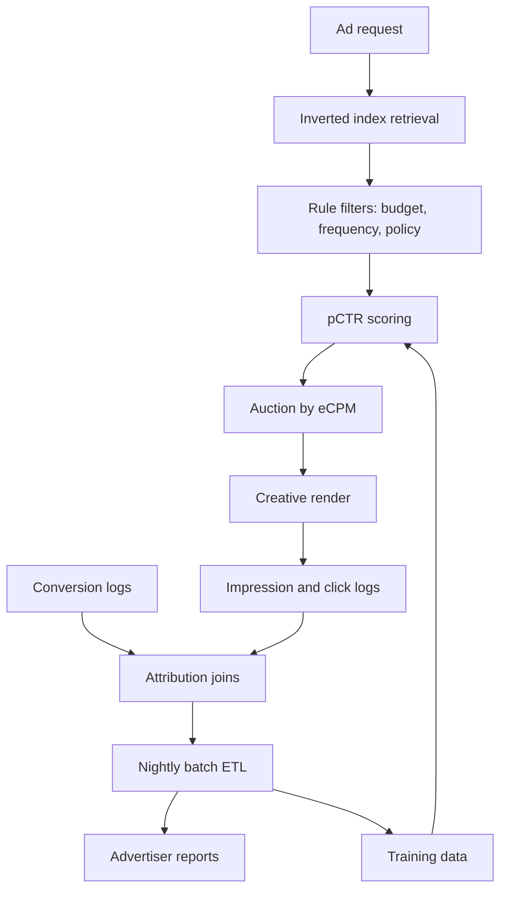
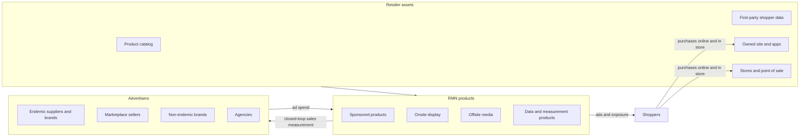
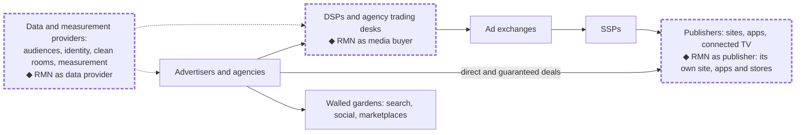
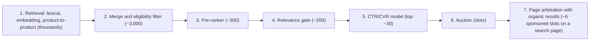

# Part I: Foundations

---

# Chapter 1: Why Retail Media: From Traditional Ad Networks to RMNs

A retail media network (RMN) sells advertising on a retailer's own properties (its website, apps and in-store screens) and, increasingly, on media it does not own, such as other websites and apps, social platforms and connected TV, where the retailer's shopper data drives targeting and its sales data drives measurement. Its serving stack descends from the display and search networks that grew in the early 2000s and matured by the mid-2010s. Those networks established the pipeline that every later ad system extends. They also made assumptions that fail on a retail site: that ads sit in their own slots, that the advertised unit is a keyword or a banner rather than a product in a catalog of hundreds of millions, and that a cookie is the best available identity.

This chapter explains why retail media needs its own architecture and where an RMN sits in the advertising market. The first half condenses the traditional networks into the lessons that carry forward, defines what an RMN is, and shows where traditional architectures break at retail scale. The second half maps the market, the three roles an RMN plays, the maturity model for how RMNs grow, and the six frameworks the rest of the book uses.

Chapter 2 then supplies the domain model and the end-to-end system map, together with the reference RMN whose numbers every chapter uses. Readers who know legacy ad tech well can skim Sections 1 and 2 and start at Section 3.

---

Table of Contents

- [1. Traditional Ad Networks](#1-traditional-ad-networks)
  - [1.1. Shared Foundations](#11-shared-foundations)
  - [1.2. Display Networks: Context and Audiences](#12-display-networks-context-and-audiences)
  - [1.3. Search Networks: Intent, Keywords and Quality Score](#13-search-networks-intent-keywords-and-quality-score)
- [2. Lessons Carried Forward](#2-lessons-carried-forward)
  - [2.1. CTR Prediction at Scale](#21-ctr-prediction-at-scale)
  - [2.2. Conversion Modeling and Bid Landscapes](#22-conversion-modeling-and-bid-landscapes)
  - [2.3. Data Pipelines and Attribution](#23-data-pipelines-and-attribution)
- [3. What Makes an RMN Different](#3-what-makes-an-rmn-different)
  - [3.1. What Is a Retail Media Network](#31-what-is-a-retail-media-network)
  - [3.2. The Three Constituencies](#32-the-three-constituencies)
  - [3.3. Why Traditional Architectures Break at Retail Scale](#33-why-traditional-architectures-break-at-retail-scale)
- [4. The RMN Market and the Three Roles](#4-the-rmn-market-and-the-three-roles)
  - [4.1. Onsite and Offsite, Endemic and Non-Endemic](#41-onsite-and-offsite-endemic-and-non-endemic)
  - [4.2. Publisher, Media Buyer and Data Provider](#42-publisher-media-buyer-and-data-provider)
- [5. The RMN Maturity Model](#5-the-rmn-maturity-model)
- [6. The Six Frameworks](#6-the-six-frameworks)
- [7. Design Decisions and Trade-offs](#7-design-decisions-and-trade-offs)
- [Summary and Next Steps](#summary-and-next-steps)
- [References and Further Reading](#references-and-further-reading)

---

## 1. Traditional Ad Networks

Traditional display and search networks differed in where demand came from (passive browsing versus a typed query), but they ran on one architecture. This section describes that architecture and then what was specific to each kind of network, because each is the historical anchor for one of the two ad formats an RMN sells: search ads for sponsored products, and display networks for onsite display.

### 1.1. Shared Foundations

When a user loads a page or submits a query, an ad request passes through a fixed sequence of stages within a page-load budget: **retrieval → scoring → auction → creative assembly → logging → measurement**.

**Campaigns and targeting**  
Advertisers organized spending as campaigns that contain ad groups, which in turn hold ads. The campaign carried the budget and flight dates. The ad group carried targeting and bids, and the ad carried the creative. Chapter 2 keeps this three-level hierarchy for the RMN and shows how it maps to each format.

**Retrieval**  
Retrieval narrowed millions of campaigns to a few hundred or a few thousand candidates using **inverted indices** that map context terms to eligible ads: targeting predicates for display, query tokens and their rewrites for search. The server intersected posting lists with Boolean logic and applied rule-based filters for exhausted budgets, frequency caps and policy violations.

**Scoring and the auction**  
Display inventory was traditionally priced by **CPM** (cost per mille): the price for 1,000 impressions. Search ads were priced by **CPC** (cost per click). To rank the two in one auction, each surviving candidate received a predicted click-through rate (pCTR), and every bid was converted into **eCPM** (effective cost per mille), the revenue the platform expects to earn from showing the ad 1,000 times:

$$
\text{eCPM} = \text{CPC}_{bid} \times p\text{CTR} \times 1000
\tag{1.1}
$$

In **Equation 1.1**, $\text{CPC}_{bid} \times p\text{CTR}$ is the expected revenue from one impression, and the factor of 1,000 puts it on the same per-thousand scale as a CPM bid. A CPC bid of \$0.50 on an ad with a 2% pCTR is worth \$0.01 per impression, an eCPM of \$10, so it competes on equal terms with a \$10 CPM bid.

eCPM measures expected revenue only, and a misleading ad can earn clicks yet disappoint the user, so networks also adjusted the ranking for quality. Search networks replaced pCTR with a broader quality score that combines expected click-through rate with ad relevance and landing page experience (**Equation 1.2**, Section 1.3), and display networks applied policy and quality filters before ranking.

**Creative assembly, logging and measurement**  
Winners were rendered (image sizes fitted to the slot for display, query keywords inserted into text for search), and every impression, click and conversion was written to logs. Attribution joined conversions back to impressions and clicks, and nightly batch jobs aggregated the logs into advertiser reports and training data. **Figure 1.1** shows the flow.

**Figure 1.1: Legacy Ad Serving and Feedback Flow**

### 1.2. Display Networks: Context and Audiences

Display advertising ran across millions of sites and apps, with weaker signals than search: the user was reading content, not declaring a need. Targeting therefore relied on **context** (the domain, its category, keywords extracted from the page) and **audiences**, segments inferred from browsing history and keyed by third-party cookies. Much display inventory was also sold programmatically: advertisers and agencies bid through **demand-side platforms (DSPs)** into **ad exchanges**, where **supply-side platforms (SSPs)** represented publishers and auctioned each impression in real time. Section 4.2 places the RMN in this chain.

Display retrieval is an *eligibility* problem. Every campaign's predicates (geography, device, topics, placements, audience segments) mapped to posting lists, and Boolean intersection plus budget filters had to reduce tens of thousands of matches to a scoring set within tens of milliseconds. Click-through rates were far lower than in search, so a small relative error in pCTR distorted the ranking badly. Display also introduced **view-through conversions**, purchases by users who saw but did not click an ad, and with them the problem of crediting exposure without crediting purchases that would have happened anyway.

By 2015 the limits were clear. Keyword and segment matching missed semantic equivalents. For example, a campaign targeting "automobiles" did not match a page about "vehicles" unless someone had built a synonym list by hand. Cookie segments were coarse and unstable, and the identity behind them was eroding. RMN display inherits the eligibility-style retrieval (the display section of Chapter 4), the delivery mechanics of frequency caps and guaranteed deals (Chapter 16), and the view-through measurement problem (Chapters 13 and 14).

### 1.3. Search Networks: Intent, Keywords and Quality Score

Search advertising matched advertiser keywords to queries in which users declared intent. Advertisers controlled matching with **match types**: *exact* (the query equals the keyword, allowing minor variants), *phrase* (the query contains the keyword phrase in order) and *broad* (the query is related to the keyword, which the system implemented by query rewriting with stems, synonyms and learned similarity rather than literal token matching). **Negative keywords** excluded unwanted queries. Retrieval looked up the query and its rewrites in a keyword index, and returned far fewer candidates than display because the query constrained the space.

**Ranking by bid and quality**  
The search auction did not rank by bid alone. In the formulation that Varian analyzed for Google's auction, ads are ranked by the product of the bid and a measure of ad quality, and each advertiser pays the minimum amount needed to keep its position [1]:

$$
\text{Ad Rank} = \text{bid} \times \text{Quality Score}
\tag{1.2}
$$

Quality Score includes the ad's expected click-through rate, so in Varian's model bid × Quality Score is essentially **Equation 1.1** (without the constant 1,000) extended with further quality signals [1]. Google describes Quality Score in three components: expected click-through rate, ad relevance and landing page experience [3]. Today Google presents Quality Score as a diagnostic rather than an auction input, and computes ad rank at auction time from the bid, ad and landing page quality, thresholds, competition and the search context [3][4]. The principle carries over unchanged: quality multiplies the bid, so the platform protects the user experience and its long-term revenue at once. Chapter 6 builds the RMN version (adjusted eCPM) and its pricing. It keeps pCTR as a separate term, as in **Equation 1.1**, and lets its Quality Score cover only the remaining components, so the click-through rate is still counted once. Chapter 5 builds the relevance and engagement models that feed it.

Under this rule an advertiser's price per click is the Ad Rank of the advertiser ranked immediately below it, divided by its own Quality Score [1]. This pricing rule is the **generalized second-price (GSP)** auction. Unlike the single-item second-price auction, GSP does not make bidding one's true value the best strategy when several slots are for sale [2], and in its stable outcomes advertisers bid below their values [1][2]. A GSP platform therefore cannot read a bid as the advertiser's true valuation, which is one reason reserve prices (Chapter 6) and autobidders (Chapter 9) matter.

**Position effects**  
Search click-through rates depend strongly on position, so CTR models trained on logged clicks confound ad quality with position, and production systems either calibrated by position or de-biased the training data. The same problem returns, in sharper form, when sponsored products sit inside a product grid (Chapter 8) and when engagement data labels relevance (Chapter 5).

Sponsored products are the descendant of search ads. Keyword targeting with match types and negatives, query rewriting for broad match, and the requirement that an ad be relevant before its bid counts all carry over. Section 3.3 explains what changes.

---

## 2. Lessons Carried Forward

The logistic-regression models of the era have been replaced, but three bodies of practice built around them remain in every production ad system. This section condenses each to the lesson that matters for an RMN and points to the chapter that develops its modern form.

### 2.1. CTR Prediction at Scale

Google's 2013 account of its production system describes the core that click prediction had settled on: logistic regression over billions of sparse features, trained online [5]. Features were categorical IDs (publisher, ad, advertiser, device, geography, hour) plus hand-built crosses. **Feature hashing** mapped feature strings into a fixed-size index space, removing vocabulary maintenance at the cost of occasional collisions, with provable bounds on their effect [6]. **FTRL-Proximal**, an online algorithm with per-coordinate learning rates and L1 regularization, kept models sparse while updating them from streaming logs [5]. Because clicks were rare, training kept every positive and a sample of negatives, re-weighted the sampled negatives and recalibrated predictions afterwards.

Of the lessons that outlived the models, the clearest is that calibration is a pricing requirement. pCTR enters the auction through **Equation 1.1**, so a model that overestimates an ad's click rate by 10% inflates its eCPM by 10%, and with it the ad's rank, however good the model's AUC. Teams measured calibration per slice and corrected it after training [5]. Freshness was the second lesson: campaigns, products and seasons change daily, and online or frequent incremental training with warm starts kept models accurate under drift. Label timing was the third: labels were assigned only after a waiting window, because a click can arrive minutes after the impression and a premature non-click label biases the model downward.

The model family broke on three limits. Hand-built crosses could not capture interactions beyond second order; sparse ID features could not generalize to semantically similar queries and items; and user history was compressed into coarse segments that discarded the order of events. Deep ranking models, embedding-based retrieval and sequence models addressed these limits. Chapter 5 covers the RMN's ranking models, including calibration; Appendix 2 implements one reference CTR/CVR model; Appendix 3 covers the sequence encoders.

### 2.2. Conversion Modeling and Bid Landscapes

Conversions were rarer and later than clicks. A conversion could arrive days after the click, so a "no conversion" label was not final until the attribution window closed, and training sets per campaign were small. Most systems modeled conversion rate after the click, $P(\text{conversion} \mid \text{click})$, reusing the CTR feature pipeline with simpler crosses and backing off to category averages for new campaigns. That framing trains on clicked impressions only but is applied to every candidate impression, a sample-selection mismatch that later multi-task ranking models address explicitly (Chapter 5, Appendix 2).

Advertisers also needed to know what a different bid would buy, and the industry called the answer a "bid landscape": the impressions, clicks and cost a keyword or campaign would receive at each possible bid, estimated from recorded auctions [7].

This book splits that term in two because the halves are estimated differently and serve different consumers. A **bid landscape** is the market side: the distribution of the price an ad must beat to win. A **bid response curve** is the advertiser side: the impressions, clicks, conversions and spend an advertiser receives as a function of its bid. The traditional "bid landscape" is, in these terms, a bid response curve. A response curve can be derived from the market-side landscape combined with the ad's own click and conversion rates. Once most advertisers use autobidding, they stop varying their bids by hand, so the platform can no longer observe response curves from their bid changes and must estimate the market-side landscape directly. Chapter 9, Section 2 develops both for an RMN, and Chapter 6 uses the market-side landscape to set reserve prices.

### 2.3. Data Pipelines and Attribution

Every model and auction depended on pipelines that joined impressions, clicks and conversions, assigned credit, assembled training data and produced reports. Attribution matched each conversion to the interactions before it within a lookback window, typically longer for clicks than for views, and applied a rule to share credit: last click, first click, or a linear, position-based or time-decay split. Late conversions were handled by backfilling labels on past impressions, which online learners then had to accept as corrections. Invalid traffic (bots, click farms, accidental double clicks) had to be filtered before it reached either billing or training data. Features were computed by nightly batch jobs, so most signals lagged by up to a day.

The operational lesson was that data quality matters as much as model sophistication. A join-key mismatch that silently drops a tenth of conversions corrupts reports, bids and models at once, and fixing it meant reprocessing every day of logs it had touched. Pipelines that survived made that backfill routine: they were partitioned by time so only the affected days were recomputed, and idempotent so a rerun replaced its earlier output instead of double-counting it. They also ran automated checks on row counts, null rates and distributions for every batch, which is how silent failures such as the dropped join were caught.

An RMN inherits all of this, with two differences that run through the book. Because exposure and purchase usually happen on the retailer's own platform, joins can be deterministic (Chapter 13). And because a rule that splits credit among observed touchpoints says nothing about what the ads caused, attribution needs a causal counterpart (Chapter 14). Fraud filtering becomes its own system in Chapter 12, and the batch feature pipelines become Chapter 3's streaming loops.

---

## 3. What Makes an RMN Different

### 3.1. What Is a Retail Media Network

A **retail media network (RMN)** is an advertising business operated by a retailer. Its advertisers are most often the retailer's own suppliers and marketplace sellers, and it sells both onsite media on the retailer's properties and offsite media elsewhere (Section 4.1). A traditional network aggregates inventory from many publishers and relies on third-party identity. An RMN is **vertically integrated**: the retailer owns the pages, the shopper relationship, the product catalog and the record of what was bought, so the link between a click and a later purchase is deterministic rather than inferred.

The business has reached the scale of the largest ad platforms. Amazon's advertising services revenue was \$31.2 billion in 2021 [8]. Walmart's global advertising business grew 46% in fiscal 2026 to nearly \$6.4 billion, including VIZIO [9]. In the United States, commerce media advertising revenue grew 18% in 2025 to \$63.4 billion, 21.5% of internet advertising revenue [10].

**Timing**  
Three developments converged. Privacy regulation raised the cost of third-party tracking: the EU's General Data Protection Regulation has applied since May 2018 [11], and California enacted the California Consumer Privacy Act in 2018 [12]. Browsers restricted third-party cookies, so first-party relationships became more valuable (see the sidebar below). E-commerce gave retailers digital audiences large enough to monetize, and the ML infrastructure to serve and rank ads at that scale became widely available outside the largest technology companies.

> **Sidebar (as of October 2026): Third-party cookies.** Safari has blocked third-party cookies by default since March 2020 [13]. Chrome, after years of plans to phase them out, announced in April 2025 that it would keep its existing approach to third-party cookie choice and would not introduce a new standalone prompt [14]. The case for retail media therefore no longer rests on cookies disappearing. It rests on what first-party, logged-in identity tied to actual purchases makes possible.

### 3.2. The Three Constituencies

An RMN serves three constituencies whose interests overlap only partly, and the platform's design is largely the management of that partial overlap.

**The retailer**  
Advertising carries far higher margins than retailing. Retail profit margins are typically 3–4%, while margins on retail media ad sales are typically 70–90% [15]. Ads monetize pages that otherwise earn nothing directly (search results, category pages, product pages). The retailer also bears the cost: every irrelevant ad spends shopper trust that the retail business depends on.

**Advertisers**  
Brands reach shoppers at the moment of purchase intent and target them with first-party purchase data. For endemic brands (Section 4.1), sponsored placement is part of competing for the digital shelf: being visible when a shopper searches the category. Their main open question is whether the sales they are credited with were caused by the ads.

**Shoppers**  
Relevant ads help discovery: a better-rated alternative, a new product, a complementary item. Irrelevant or excessive ads cost attention and reduce engagement with the site as a whole. Shoppers do not pay for ads directly, but their long-term behavior is what both the retailer and the advertisers are buying.

Because each constituency is represented by a different internal owner (the ads business, merchandising and search, the shopper experience teams), the trade-offs between them are organizational as well as technical. Chapter 8 makes them explicit as four objectives the page must balance: ad revenue, organic sales and retail margin, long-term shopper trust, and advertiser return.

### 3.3. Why Traditional Architectures Break at Retail Scale

The traditional pipeline of Section 1 is the right skeleton for an RMN, but six of its assumptions fail on a retail site.

**The catalog becomes the inventory**  
On a retail site the advertised unit for sponsored products is a product in the catalog, not a keyword or a banner. The reference RMN used throughout this book (Chapter 2) has a catalog of about 400 million SKUs, of which about 5 million are advertised, appearing as about 10 million **advertised products**: (SKU, ad group) pairs, because one SKU can be advertised in several ad groups. Retrieval becomes a relevance search over products, using lexical matching, embedding-based retrieval and product-to-product relations, rather than a keyword lookup (Chapter 4).

**Ads share the page with organic results**  
Traditional networks placed ads in their own slots, next to content they did not own. A retailer runs both the search engine and the ad business on the same results page, so every sponsored listing displaces an organic one, and someone must decide how many ads a page carries and where (Chapter 8).

**Measurement is closed-loop, which makes causality visible**  
Because exposure and purchase are logged under the same shopper account, the reference RMN aims for exact sales reporting within hours rather than the probabilistic, cookie-based attribution that arrives days later, and it can run experiments at the level of individual shoppers. The same closed loop exposes an uncomfortable fact: a shopper who searched for a product was often going to buy it, so attributed returns overstate what the ad caused. The advertisers' open question from Section 3.2, whether the ads caused the sales, becomes the RMN's central credibility question: incrementality (Chapters 13 and 14).

**Identity is first-party, until data leaves the retailer**  
Logged-in accounts and loyalty programs replace third-party cookies as the identity layer inside the retailer, and the privacy task shifts from obtaining consent for third-party tracking to stewardship of first-party data. As soon as the RMN buys media elsewhere, accepts an advertiser's customer list or measures conversions on an advertiser's site, it needs two capabilities. **Identity resolution** links records that refer to the same person across systems, either deterministically through a shared identifier such as a logged-in account or probabilistically through weaker signals such as device and location. **Clean rooms** are controlled environments in which two or more parties join their data under query and output restrictions, so that each sees only approved, aggregated results and never the other's raw records. Chapter 15 builds both, and Appendix 4 compares identity solutions.

**Latency budgets tighten while models deepen**  
Sponsored products are rendered inside the search results page, so the ad stack works within the page's budget. The reference RMN allows 60 ms at the 99th percentile for search-integrated ads, at a peak of 50,000 ad requests per second, while ranking with models far heavier than a sparse dot product. Meeting both requires the staged ranking cascade introduced in Section 6 (Chapters 3–5).

**Shopper history is rich and sequential**  
A retailer sees searches, views, carts and purchases, online and in store, in order, and sequence models over those actions can feed retrieval, ranking and audiences from one learned representation (Chapter 5, Section 7; Chapter 11; Appendix 3).

**Table 1.1** summarizes the differences, including the parts of the system the six points do not single out (bidding, audiences and creative), and shows where the book covers each modern version.

**Table 1.1: From Traditional Ad Networks to RMNs**

| Dimension | Traditional networks (Sections 1–2) | Retail media networks | Where |
|---|---|---|---|
| **Inventory** | Aggregated from many publishers via exchanges | The retailer's own properties, plus offsite media bought with its data | Ch2, Ch17 |
| **Advertised unit** | Keyword-targeted text ad or banner creative | Sponsored products: an advertised product (a SKU in an ad group); display: an ads line item and its creatives | Ch2 |
| **Retrieval** | Keyword and predicate lookup in inverted indices | Multi-path relevance search over advertised products (lexical, embedding, product-to-product); eligibility evaluation for display | Ch4, A1 |
| **Ranking** | Logistic regression with feature crosses | Separate relevance (cross-encoder) and CTR/CVR (multi-tower) models; user-sequence foundation models | Ch5, A2, A3 |
| **Page composition** | Fixed ad slots, filled by eCPM (**Equation 1.1**) | Page arbitration that weighs ad value against organic value and shopper trust under a governed ad load | Ch8 |
| **Bidding** | Manual bids and rules | Autobidding toward ROAS and CPA targets; campaign automation | Ch9 |
| **Audiences** | Coarse cookie-based segments | Predictive propensity, lifetime-value and uplift models on first-party data | Ch11 |
| **Creative** | Manual static assets | Generated, reviewed and selected creatives in a closed learning loop | Ch10 |
| **Measurement** | Probabilistic, cookie-based attribution: did the ad lead to a conversion | Deterministic, closed-loop attribution, including in-store sales, plus incrementality: did the ad cause the sale | Ch13, Ch14 |
| **Identity and data** | Third-party cookies, probabilistic identity graphs | First-party accounts and loyalty IDs inside the retailer; identity resolution, clean rooms and data collaboration across its boundary | Ch15, Ch17, A4 |

---

## 4. The RMN Market and the Three Roles

### 4.1. Onsite and Offsite, Endemic and Non-Endemic

Two distinctions organize the market. **Onsite** media runs on the retailer's own properties (website, apps, in-store screens). **Offsite** media runs on third-party inventory (the open web, social platforms, connected TV) using the retailer's shopper data for targeting and its sales data for measurement. On the demand side, an **endemic** advertiser is a brand whose products the retailer sells; a **non-endemic** advertiser does not sell through the retailer's catalog, such as a bank, an automaker or a telecom provider, and buys access to the retailer's audience rather than to its shelf.

**Table 1.2** crosses the two distinctions. Each cell has different needs: onsite endemic advertising is the core sponsored-products business; the other three cells all require something to cross the retailer's boundary.

**Table 1.2: The RMN Market by Placement and Advertiser Type**

| | Endemic advertiser | Non-endemic advertiser |
|---|---|---|
| **Onsite** | A detergent brand's sponsored product in results for "laundry detergent"; a brand's homepage banner for a seasonal line | A credit-card offer on the checkout page; an insurer's banner on automotive category pages |
| **Offsite** | The detergent brand reaching the retailer's recent buyers on connected TV, measured against in-store and online sales | A telecom provider reaching the retailer's shoppers on the open web, with conversions on the telecom's own site |

**Figure 1.2** shows the business model as a whole: what the retailer brings, who takes part, what the RMN sells and how value flows.

**Figure 1.2: The RMN Business Model**

> **Design trade-off: Endemic demand only vs. opening the network to non-endemic advertisers.** Serving only endemic advertisers keeps every ad tied to a product the shopper can buy on the page and keeps measurement inside the retailer. Opening to non-endemic advertisers adds demand for display and audience products, but their conversions happen on their own sites, so measurement needs identity matching and clean rooms. Choose endemic only until display inventory and the cross-boundary machinery of Chapter 15 exist; open to non-endemic demand when display fill or audience revenue justifies it (Chapter 16).

### 4.2. Publisher, Media Buyer and Data Provider

A mature RMN creates value in three distinct ways, and the book refers to them as the **three roles** (**Table 1.3**).

**Table 1.3: The Three RMN Roles**

| Role | What it sells | Main chapters |
|---|---|---|
| **Publisher** | Its own onsite inventory: sponsored products and display | Part II, Ch16 |
| **Media buyer** | Offsite inventory bought on advertisers' behalf, through its own or partner DSPs | Ch17 |
| **Data provider** | Audiences, clean-room collaboration, measurement as a service, shopper insights | Ch17, Ch15 |

The roles differ in what must cross the retailer's boundary. As a publisher selling to endemic advertisers, the RMN keeps exposure, conversion and identity in house, and joins between them are deterministic (Chapter 13). As a media buyer, the exposure happens on someone else's site while the sale happens at the retailer, so audiences must be activated on partner platforms and exposures matched back to sales. As a data provider, data and measurement serve media the RMN did not sell at all. Wherever exposure or conversion happens outside the retailer, identity matching and privacy controls are required, and Chapter 15 builds them as shared components. We call this the **retailer boundary**.

**Figure 1.3** draws the traditional internet advertising ecosystem, from advertisers through DSPs, exchanges and SSPs to publishers (Section 1.2), and marks the positions an RMN occupies. **Walled gardens** (search engines, social platforms, large marketplaces) sell their own inventory with their own data alongside that chain, and data and measurement providers supply audiences, identity, clean rooms and measurement to buyers. A mature RMN sits in three of these positions at once, and as a publisher that sells its own inventory with its own data and measurement it also resembles a walled garden.

**Figure 1.3: The RMN in the Internet Advertising Ecosystem**

*Solid lines: buying and ad delivery. Dashed lines: data and measurement. ◆ and dashed borders: positions an RMN occupies.*

> **Design trade-off: Publisher only vs. adding the media-buyer and data-provider roles.** Staying a publisher keeps all data inside the retailer and measurement deterministic, but caps revenue at the retailer's own traffic. Adding offsite buying and data products extends reach and gives advertisers closed-loop measurement for media bought elsewhere, at the cost of identity resolution, clean rooms, partner integrations and a larger privacy surface. Add the other roles once the onsite stack is stable and the boundary machinery of Chapter 15 is in place (Chapter 17).

---

## 5. The RMN Maturity Model

RMNs do not build everything at once. The **RMN maturity model** describes four stages, each defined by what the network sells and what it must therefore build (**Table 1.4**). It is this book's framework for sequencing work.

**Table 1.4: The RMN Maturity Model**

| Stage | What the RMN sells | What it must build | Main chapters |
|---|---|---|---|
| **1. Sponsored products only** | Sponsored products on search and item pages to endemic advertisers, priced by CPC, with keyword targeting | Lexical retrieval with Boolean eligibility, rule-based or simple relevance, a GSP auction, budgets and throttling; attributed sales reporting | Ch2, Ch3, Ch4, Ch6, Ch7 |
| **2. ML ranking and auction** | Sponsored products with auto-targeting and autobidding | Embedding-based and product-to-product retrieval, relevance and CTR/CVR models, a quality-weighted auction, autobidding, governed ad load; periodic lift experiments for large advertisers | Ch4, Ch5, Ch6, Ch8, Ch9, Ch14 |
| **3. Display, offsite and data products** | Onsite display (auction and guaranteed), brand units, offsite media, audience and measurement products, non-endemic demand; the media-buyer and data-provider roles join the publisher role | Display delivery and forecasting, creative systems, predictive audiences, identity and clean rooms; reach, always-on holdouts with iROAS reporting, geo lift tests and media mix models | Ch10, Ch11, Ch14, Ch15, Ch16, Ch17 |
| **4. Agent-ready commerce media** | Placements and product content that reach shoppers through agents as well as pages | API-first serving, agent-traffic classification, delegated consent; measurement of agent-completed purchases (open) | Ch18 |

The stages describe dependency rather than a strict timeline: a quality-weighted auction needs trustworthy relevance and engagement models, offsite and non-endemic media need the identity and clean-room machinery, and selling to agents needs everything below it to be callable and measurable without a page. Fraud defense (Chapter 12) and measurement inside the retailer (Chapter 13) are needed at every stage, from the first paid click.

Stage 4 is the least settled. It responds to AI agents that search, compare and buy on a shopper's behalf, which challenge the assumption under every system in this book that a human sees the page. If an agent reads the results, the questions become what an ad is to an agent, how a sponsored product earns a place in its recommendations, how agent traffic is told apart from bots, who consented to the purchase and whether an ad caused a sale that an agent completed. Chapter 18 treats these as open problems and labels each approach as proven, emerging or open.

> **Sidebar (as of October 2026): Early agentic checkout protocols.** In September 2025, Stripe and OpenAI released the Agentic Commerce Protocol, an open standard that lets merchants sell through AI agents with a single integration, alongside Instant Checkout in ChatGPT for purchases from Etsy sellers and Shopify merchants in the United States [16]. In the same month, Google announced the Agent Payments Protocol (AP2), which records a user's instructions as cryptographically signed "mandates" so that merchants and payment providers can verify that an agent was authorized to make a specific purchase [17]. Both are early and changing quickly; Chapter 18 re-examines the field.

Three decisions recur at the boundaries between stages.

> **Design trade-off: Build the ad stack in house vs. license a retail media platform.** Licensing a vendor platform gets sponsored products to market faster and transfers operational risk, but the ranking, auction and measurement logic sit outside the retailer's control, and the shopper data must flow to or through the vendor. Building takes longer and needs a dedicated engineering and science organization, but lets the retailer tune relevance, ad load and incrementality to its own economics. License to launch at Stage 1 when traffic is modest; build, or bring the ranking and measurement core in house, as the network approaches Stage 2.

> **Design trade-off: Sponsored products first vs. display first.** Sponsored products sell to the suppliers already in the catalog, monetize high-intent search traffic and need no creative production, so they generate revenue fastest. Display first suits a retailer whose traffic is mostly browsing rather than searching, but it requires creative operations, viewability measurement and often guaranteed-delivery machinery from the start. Start with sponsored products unless search traffic is small; add display in Stage 3 on the same serving stack (Part II's "Display Placements: What Changes" subsections).

> **Design trade-off: Managed service vs. self-serve.** In a managed service, the RMN's account teams set up and run campaigns, which suits a small number of large advertisers, complex display deals and early products. Self-serve gives advertisers a console and APIs, which scales to tens of thousands of advertisers but requires stable controls, guardrails, real-time reporting and a control plane that propagates changes safely (Chapter 3). Run sponsored products self-serve as soon as their controls stabilize; keep guaranteed display and data products managed until their workflows are standardized.

---

## 6. The Six Frameworks

The book uses six named frameworks. Each is introduced here with the chapter that owns it; later chapters refer to them by name, and only where they apply.

**The RMN maturity model**  
The four stages of Section 5, from sponsored products alone to agent-ready commerce media. Every chapter's Design Decisions and Trade-offs section uses them to say what to build first.

**Sponsored products vs. display**  
The two ad formats share one serving stack but differ in what is retrieved (an advertised product versus an ads line item), how creative is produced, how they are priced and bought, and how they are measured. Part II uses sponsored products as the primary example and gives each of its chapters a "Display Placements: What Changes" subsection. Chapter 2 defines the formats; Chapter 16 covers what is unique to the display business.

**The ranking cascade**  
Every ad request passes through the same sequence of progressively more expensive stages, each working on fewer candidates (**Figure 1.4**). Retrieval paths produce candidates with their own scores; they are merged and filtered for eligibility; a pre-ranker trims them cheaply; a relevance gate removes off-topic ads regardless of bid; the CTR/CVR model scores the rest; the auction ranks and prices; and page arbitration places the winners among organic results. Chapter 3 sets the cascade's latency budget, Chapters 4 to 6 and 8 cover its stages, and all of them draw it the same way.

**Figure 1.4: The Ranking Cascade**

**The three roles and the retailer boundary**  
An RMN acts as publisher, media buyer and data provider (Section 4.2). Whether identity matching is needed depends on where exposure and conversion happen: inside the retailer, joins are deterministic (Chapter 13); across the boundary, identity resolution, clean rooms and privacy controls are required (Chapter 15). Chapter 17 covers the media-buyer and data-provider roles as businesses.

**Attribution vs. incrementality**  
Attribution assigns credit for sales that happened to the ads a shopper saw or clicked; incrementality measures the sales that the ads caused. For an RMN the gap between them is the core credibility problem. Chapter 2 states the distinction; Chapter 14 owns the methods (experiments, predicted lift, and reconciliation with attribution and media mix models), and Chapters 6, 9 and 11 use incremental value in ranking, bidding and targeting.

**Ads vs. organic**  
The retailer's search results and its ads compete for the same page, so every page balances ad revenue against organic sales and retail margin, long-term shopper trust and advertiser return. Chapter 8 owns this framework: slot economics, arbitration on search, browse, item, home and cart pages, the blender component that composes the page, and how ad load is set and governed.

---

## 7. Design Decisions and Trade-offs

This chapter's decisions are strategic: what kind of RMN to build, in what order, and with whom. **Table 1.5** collects the trade-off callouts above; its last column places each decision on the maturity model.

**Table 1.5: Strategic Design Decisions for an RMN**

| Decision | Options | What each buys | When to choose |
|---|---|---|---|
| Demand scope (§4.1) | Endemic only vs. opening to non-endemic advertisers | Endemic: every ad is shoppable, measurement stays inside. Non-endemic: more demand for display and audiences | Open when display inventory and the Chapter 15 machinery exist |
| Roles (§4.2) | Publisher only vs. adding media buyer and data provider | Publisher: simple, deterministic, private. More roles: reach beyond owned traffic, closed-loop measurement for outside media | Add roles after the onsite stack is stable and the boundary machinery is in place |
| Ad stack sourcing (§5) | Build in house vs. license a retail media platform | Licensing: speed to market, shared operational risk. Building: control over relevance, ad load and measurement; data stays in house | License to launch at Stage 1; build or insource the ranking and measurement core approaching Stage 2 |
| First format (§5) | Sponsored products first vs. display first | Sponsored products: fastest revenue from existing suppliers, no creative production. Display: monetizes browsing traffic and brand budgets | Sponsored products first unless search traffic is small; display in Stage 3 on the same stack |
| Operating model (§5) | Managed service vs. self-serve | Managed: flexibility for complex and early products. Self-serve: scale to tens of thousands of advertisers | Self-serve sponsored products once controls stabilize; managed for guaranteed display and data products until standardized |

---

## Summary and Next Steps

Traditional display and search networks established the pipeline every ad system still runs and the disciplines that keep it honest: calibrated predictions, because they set prices; fresh models and correctly timed labels; bid landscapes for forecasting; and data pipelines whose quality matters as much as the models they feed. Display networks anchor onsite display, and search networks anchor sponsored products.

An RMN is a vertically integrated ad business serving retailers, advertisers and shoppers, whose interests overlap only partly, and on its site the traditional assumptions break. The advertised unit becomes a product in a catalog of hundreds of millions, so retrieval becomes a relevance search. Ads share the page with the retailer's own results, so the ad system is accountable for what it displaces. Measurement becomes closed-loop, which makes the gap between attributed and incremental sales visible. Identity is first-party until data crosses the retailer's boundary, and latency budgets tighten while models deepen.

The RMN sells onsite and offsite media to endemic and non-endemic advertisers and plays three roles: publisher, media buyer and data provider. The maturity model sequences what it builds, from sponsored products alone to agent-ready commerce media, and the six frameworks of Section 6 recur throughout the book.

Chapter 2 turns from why to what, defining the RMN's domain model, the ad formats, targeting, the advertiser lifecycle and the end-to-end system map that Part II builds out, and introducing the reference RMN whose numbers every later chapter uses.

---

## References and Further Reading

[1] Varian, H. R. (2007). "Position Auctions." *International Journal of Industrial Organization*, 25, 1163–1178. https://doi.org/10.1016/j.ijindorg.2006.10.002 (author's copy verified at https://zoo.cs.yale.edu/classes/cs455/fall11/2007%20position%20auction.pdf, Accessed October 2026). Section 8 states that Google ranks ads by the product of a measure of ad quality and the advertiser's bid, and that each advertiser pays the minimum amount necessary to retain its position. Section 5 shows that under VCG truthful reporting is optimal and interprets each agent's VCG payment as the harm its presence imposes on the others; the equilibrium bid recursions of Section 2 lie below the bidders' values.

[2] Edelman, B., Ostrovsky, M., & Schwarz, M. (2007). "Internet Advertising and the Generalized Second-Price Auction: Selling Billions of Dollars Worth of Keywords." *American Economic Review*, 97(1), 242–259. https://www.aeaweb.org/articles?id=10.1257/aer.97.1.242 (Accessed October 2026). Shows that GSP generally has no dominant-strategy equilibrium and that truth-telling is not an equilibrium, while the generalized English auction has a unique equilibrium with the same payoffs as the dominant-strategy equilibrium of VCG.

[3] Google Ads Help. "About Quality Score for Search campaigns." Google Support. https://support.google.com/google-ads/answer/6167118 (Accessed October 2026). Lists the three Quality Score components (expected clickthrough rate, ad relevance, landing page experience) and states that Quality Score is not an input in the ad auction but a diagnostic tool.

[4] Google Ads Help. "Ad Rank: Definition." Google Support. https://support.google.com/google-ads/answer/1752122 (Accessed October 2026). Lists the factors used to calculate Ad Rank at auction time: bid, ad and landing page quality, Ad Rank thresholds, auction competitiveness, the context of the search, and the expected impact of assets and other ad formats.

[5] McMahan, H. B., Holt, G., Sculley, D., Young, M., Ebner, D., Grady, J., Nie, L., Phillips, T., Davydov, E., Golovin, D., Chikkerur, S., Liu, D., Wattenberg, M., Hrafnkelsson, A. M., Boulos, T., & Kubica, J. (2013). "Ad Click Prediction: a View from the Trenches." *Proceedings of the 19th ACM SIGKDD International Conference on Knowledge Discovery and Data Mining (KDD 2013)*. https://doi.org/10.1145/2487575.2488200; Google Research: https://research.google/pubs/pub41159/ (Accessed October 2026). Describes Google's production CTR prediction with FTRL-Proximal online learning, per-coordinate learning rates, memory-saving techniques and calibration.

[6] Weinberger, K., Dasgupta, A., Langford, J., Smola, A., & Attenberg, J. (2009). "Feature Hashing for Large Scale Multitask Learning." *Proceedings of the 26th International Conference on Machine Learning (ICML 2009)*, 1113–1120. https://arxiv.org/abs/0902.2206; proceedings entry: https://mlanthology.org/icml/2009/weinberger2009icml-feature (Accessed October 2026). Introduces exponential tail bounds for feature hashing and shows that interference between hashed subspaces is negligible with high probability.

[7] Google Ads Help. "Estimate your results with bid, budget, and target simulators." Google Support. https://support.google.com/google-ads/answer/2470105 (Accessed October 2026). States that bid simulators collect and analyze data from ad auctions, considering Quality Score, keyword traffic and competition, to estimate results at other bid amounts.

[8] Amazon.com, Inc. (2022). "Amazon.com Announces Fourth Quarter Results." Press release, February 3, 2022. https://ir.aboutamazon.com/news-release/news-release-details/2022/Amazon.com-Announces-Fourth-Quarter-Results/default.aspx (Accessed October 2026). The supplemental net-sales table reports advertising services of \$6,381M, \$7,451M, \$7,612M and \$9,716M for the four quarters of 2021, \$31.16 billion for the year.

[9] Walmart Inc. (2026). "Walmart reports Q4 results." Earnings release, February 19, 2026. https://stock.walmart.com/sec-filings/all-sec-filings/content/0000104169-26-000032/earningsreleasefy26q4.htm (Accessed October 2026). States that Walmart's "global advertising business grew 46% to nearly \$6.4 billion, including VIZIO" in fiscal 2026.

[10] Sullivan, L. (2026). "IAB: Ad Revenue Reached \$294.6B In 2025." *MediaPost*, April 16, 2026. https://www.mediapost.com/publications/article/414357/iab-ad-revenue-reached-2946b-in-2025.html (Accessed October 2026). Reports the IAB/PwC Internet Advertising Revenue Report: Full Year 2025: US internet advertising revenue of \$294.6 billion (up 13.9%), with commerce media up 18% to \$63.4 billion, 21.5% of media spend.

[11] European Commission. "Legal framework of EU data protection." https://commission.europa.eu/law/law-topic/data-protection/legal-framework-eu-data-protection_en (Accessed October 2026). States that the General Data Protection Regulation entered into force on 24 May 2016 and applies since 25 May 2018.

[12] State of California, Office of the Attorney General. "California Consumer Privacy Act (CCPA)." https://oag.ca.gov/privacy/ccpa (Accessed October 2026). Describes the California Consumer Privacy Act of 2018 and its amendment by the CPRA, in effect from January 1, 2023.

[13] Wilander, J. (2020). "Full Third-Party Cookie Blocking and More." *WebKit Blog*, March 24, 2020. https://webkit.org/blog/10218/full-third-party-cookie-blocking-and-more/ (Accessed October 2026). Announces that cookies for cross-site resources are blocked by default across the board in Safari.

[14] Chavez, A. (2025). "Next steps for Privacy Sandbox and tracking protections in Chrome." *Privacy Sandbox blog*, Google, April 22, 2025. https://privacysandbox.google.com/blog/privacy-sandbox-next-steps (Accessed October 2026). States that Google will maintain its current approach to offering users third-party cookie choice in Chrome and will not roll out a new standalone prompt for third-party cookies.

[15] von Hoffman, C. (2025). "Why we care about retail media networks." *MarTech*, July 15, 2025 (updated April 8, 2026). https://martech.org/why-we-care-about-retail-media-networks/ (Accessed October 2026). Citing BCG, reports that retail profit margins tend to be 3–4% while the margin on retail media ad sales is usually 70–90%.

[16] Stripe. (2025). "Stripe powers Instant Checkout in ChatGPT and releases Agentic Commerce Protocol codeveloped with OpenAI." Stripe Newsroom, September 29, 2025. https://stripe.com/newsroom/news/stripe-openai-instant-checkout (Accessed October 2026). Describes Instant Checkout for US ChatGPT users buying from Etsy and Shopify merchants, and the Agentic Commerce Protocol as an open standard that lets merchants sell through AI agents with a single integration.

[17] Parikh, S., & Surapaneni, R. (2025). "Powering AI commerce with the new Agent Payments Protocol (AP2)." *Google Cloud Blog*, September 16, 2025. https://cloud.google.com/blog/products/ai-machine-learning/announcing-agents-to-payments-ap2-protocol (Accessed October 2026). Introduces AP2, an open protocol for agent-led payments, in which cryptographically signed intent and cart mandates provide verifiable proof of a user's instructions.
