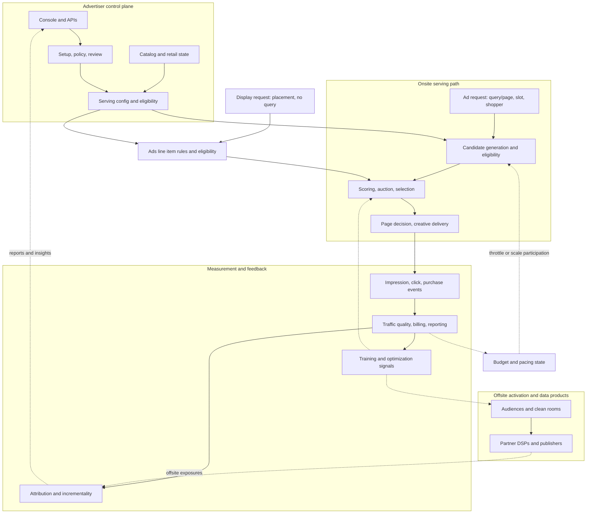
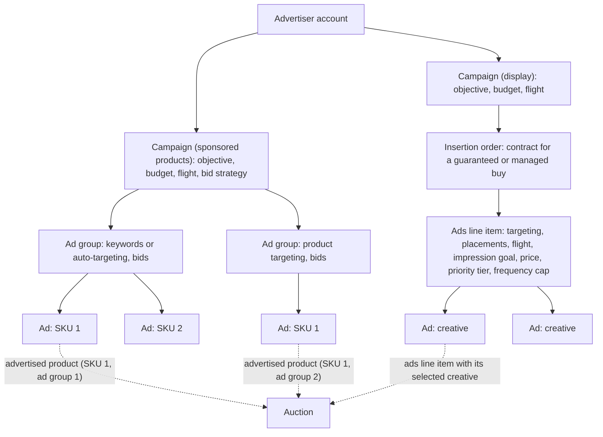
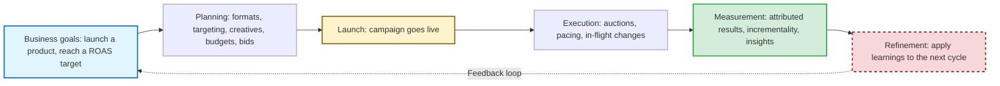

# Chapter 2: The RMN Domain and System Map

Chapter 1 established why retail media becomes its own engineering problem. This chapter turns that argument into an operating model. It defines the objects the platform stores, the systems that move those objects into serving, and the measurements that come back out. Later chapters assume these definitions are stable. When we say *campaign*, *ad group*, *ads line item*, *advertised product*, *target ROAS*, or *incrementality*, this chapter fixes what those terms mean.

It also introduces the **reference RMN**, the fictional large retailer whose traffic, catalog, latency budgets, and cascade sizes anchor the rest of the book. That shared profile keeps later numbers honest: a retrieval budget has to fit inside the serving budget, and a candidate count has to match the traffic and fleet size the platform is built to handle.

Section 1 frames the RMN as a control plane, a serving path, and a measurement loop, then anchors later numbers in the reference RMN. Section 2 defines the ontology. Section 3 follows the advertiser through the operating loop from planning to measurement. Sections 4 and 5 turn that loop into campaign setup, budget and bid controls, and in-flight optimization. Section 6 closes with the measurement model the rest of the book builds on, especially the distinction between attribution and incrementality. Sponsored products remain the primary example, with display defined alongside them so later chapters can say what changes without redefining the basics.

---

Table of Contents

- [1. The System Map and a Reference RMN](#1-the-system-map-and-a-reference-rmn)
  - [1.1. The End-to-End System Map](#11-the-end-to-end-system-map)
  - [1.2. A Reference RMN](#12-a-reference-rmn)
- [2. Core RMN Ontology](#2-core-rmn-ontology)
  - [2.1. Entity Hierarchy](#21-entity-hierarchy)
  - [2.2. Glossary of Core Terms](#22-glossary-of-core-terms)
- [3. The Advertiser Lifecycle](#3-the-advertiser-lifecycle)
- [4. Ads Planning: Campaign Setup](#4-ads-planning-campaign-setup)
  - [4.1. Campaign Management](#41-campaign-management)
  - [4.2. Ad Formats: Sponsored Products vs. Display](#42-ad-formats-sponsored-products-vs-display)
  - [4.3. Targeting and Audience Strategy](#43-targeting-and-audience-strategy)
    - [4.3.1. Placement Types](#431-placement-types)
    - [4.3.2. Targeting Mechanisms](#432-targeting-mechanisms)
    - [4.3.3. Common Combinations](#433-common-combinations)
- [5. Running Campaigns](#5-running-campaigns)
  - [5.1. Budget Management](#51-budget-management)
  - [5.2. Bidding and Auctions](#52-bidding-and-auctions)
  - [5.3. Advertiser Controls and In-Flight Changes](#53-advertiser-controls-and-in-flight-changes)
- [6. Measurement and Attribution](#6-measurement-and-attribution)
  - [6.1. Core Metrics](#61-core-metrics)
  - [6.2. Attribution Models](#62-attribution-models)
  - [6.3. Incrementality and Experimentation](#63-incrementality-and-experimentation)
  - [6.4. Closing the Loop](#64-closing-the-loop)
- [7. Design Decisions and Trade-offs](#7-design-decisions-and-trade-offs)
- [Summary and Next Steps](#summary-and-next-steps)
- [References and Further Reading](#references-and-further-reading)

---

## 1. The System Map and a Reference RMN

### 1.1. The End-to-End System Map

Chapter 1 drew the RMN as a business (**Figure 1.2**) and as a position in the advertising ecosystem (**Figure 1.3**). **Figure 2.1** is the operating view used throughout the rest of the book: how advertiser changes become serving state, how one ad request moves through the onsite stack, and how events come back as billing, reporting and learning signals. The point here is orientation, not a component contract. Later chapters unpack the services, latency budgets and failure behavior in detail.

**Figure 2.1: The RMN Operating Map: Control Plane, Serving Path and Measurement Loop**

*Solid lines: configuration and request flow. Dashed lines: feedback from events and state.*

**The control plane**  
Advertisers create and change campaigns through a console or APIs. The control plane validates each change, sends new creatives through ad review (Chapter 10), joins advertised SKUs with catalog state such as price, stock and eligibility, and turns that input into the serving configuration consumed online. Chapter 3 takes up how those changes propagate safely.

**The serving path**  
A sponsored-products request follows the ranking cascade of Chapter 1, Section 6.1, from candidate generation and eligibility, through scoring and pricing, to the page decision and creative delivery. Budget pacing acts before the final selection, either by throttling participation or by scaling bids (Section 5.1). Chapters 3 through 8 decompose that path stage by stage.

**Where display branches off**  
A display request comes from a placement, such as a homepage hero slot, and carries no query. Its candidates are ads line items whose targeting rules match the page and the shopper, subject to delivery and frequency rules; guaranteed commitments may be allocated before the auction, and the remaining inventory uses the same serving stack. Display and sponsored products then compete for the same page in page arbitration (Chapter 8).

**Where offsite branches off**  
Offsite media does not use the onsite serving path. The RMN activates audiences on partner DSPs and publishers through clean rooms, and offsite exposures return to the measurement systems to be matched with sales (Chapters 15 and 17).

**The measurement loop**  
Every served ad, click and purchase becomes an event. Those events drive billing and budget state, attribution (Chapter 13), incrementality measurement (Chapter 14) and the training or optimization signals used later in the stack (Chapters 5 and 11). Reports flow back to advertisers, and the loop closes in the control plane.

### 1.2. A Reference RMN

Numbers in an architecture book only help when they agree: a retrieval budget must fit the end-to-end budget, and a cascade size must fit the traffic it sustains. The book therefore uses one **reference RMN**: a **fictional composite** retailer at the scale of the largest US retail media networks, built from public reporting and round engineering assumptions. It does not describe any company. For scale, Walmart reported that its global advertising business grew 46% in fiscal 2026 to nearly \$6.4 billion, including VIZIO [1]; the reference RMN's onsite advertising revenue of about \$5 billion is of that order. **Table 2.1** gives the profile, for the US onsite business at peak season.

**Table 2.1: The Reference RMN Profile**

| Quantity | Value | Basis |
|---|---|---|
| Annual onsite ad revenue | ~\$5B | Public scale of the largest US RMNs, rounded |
| Monthly active online shoppers | ~120M | Assumption |
| Known customer profiles | ~200M, online and in-store loyalty; used for closed-loop measurement | Assumption |
| Monthly sessions, web and app | ~800M | Assumption |
| Catalog | ~400M SKUs, first-party and marketplace | Assumption |
| Advertised products | ~10M (SKU, ad group) pairs over ~5M distinct SKUs | Assumption |
| Ad groups | ~1M | Derived: ~10 advertised products per ad group |
| Advertiser keyword targets | ~30M (keyword, ad group) pairs | Assumption |
| Active advertisers | ~50K suppliers, marketplace sellers and agencies | Assumption |
| Active display ads line items | ~10K, about 5% guaranteed | Assumption |
| Ad requests | Design point: ~15K/s average (~1.3B/day), ~50K/s peak | Derived below, with headroom |
| Sponsored impressions | ~3B/day | Derived below |
| End-to-end ad latency (p99) | Search-integrated ≤ 60 ms; item and home placements ≤ 100 ms; asynchronous display ≤ 150 ms | Design budget (Ch3) |
| Stage latency budgets (p99) | Retrieval ≤ 15 ms; ranking model ≤ 20 ms for ~300 candidates; auction and pacing ≤ 5 ms; page arbitration ≤ 5 ms | Design budget (Ch3) |
| Ranking cascade | ~3,000 merged candidates → ~300 after the pre-ranker → ~200 after the relevance gate → top ~30 to the auction → ~6 sponsored slots on a search page, ~8 in an item-page carousel | Design budget (Ch1 **Figure 1.4**; Ch4, Ch5) |

The rows relate to each other in three ways, and later chapters rely on the same arithmetic.

**Traffic**  
About 800 million sessions a month at about 4.7 page views per session is about 3.8 billion page views a month, or about 1,400 page views per second on average. Each page view issues about 4 ad requests (several placements, plus prefetching for the next screen), which gives about 6,000 ad requests per second on a typical day, or about 500 million a day, and a holiday peak runs 3 to 4 times higher. The profile's design point of 15,000 requests per second on average and 50,000 at peak is about 2 to 3 times the derived load. That headroom is a deliberate capacity-planning choice: a traffic spike, a retry storm or a regional failover must not break the latency budget. Chapter 3 sizes the serving fleet against the design point.

**Revenue**  
About 500 million ad requests a day, each serving about 6 sponsored ads on average (a search page fills about 6 slots, and every product in an item-page carousel counts), is about 3 billion sponsored impressions a day. \$5 billion a year is about \$13.7 million a day, so the effective CPM is about \$4.6. That is consistent with an average cost per click of about \$1 and a click-through rate of about 0.5% per served impression, which by **Equation 1.1** gives an eCPM of \$5. The click-through rate per served impression is low because many carousel positions are served but never scrolled into view.

**Catalog and demand**  
About 5 million of the 400 million SKUs are advertised, each in two ad groups on average: about 10 million advertised products (Section 2.1), and at about 10 per ad group, about 1 million ad groups, or 20 per advertiser. The retrieval index (Chapter 4) is sized by advertised products and keyword targets, not by the whole catalog.

---

## 2. Core RMN Ontology

### 2.1. Entity Hierarchy

The book uses one three-level hierarchy for both ad formats, **Campaign → Ad Group → Ad**, the same hierarchy search networks used (Chapter 1, Section 1.1). Each level has the same job in both formats; what it contains differs (**Table 2.2**).

**Table 2.2: The Entity Hierarchy by Format**

| Level | Sponsored products | Display |
|---|---|---|
| **Campaign** | Objective, budget, flight, default bid strategy | The same; contracted buys are documented by an insertion order |
| **Ad group** | Ad group: targeting (keywords, auto-targeting or products), bids, optional budget | **Ads line item**: targeting, placements, flight, impression goal or budget, price, priority tier, frequency cap |
| **Ad** | A reference to one SKU; creative assembled from catalog data | A creative: image, video or HTML asset |
| **Unit retrieved** | **Advertised product**: an (SKU, ad group) pair | An ads line item, then one of its creatives |

A **campaign** is the top-level container, and its **flight** is its active period (ad groups and ads line items have flights too). An **ad group** holds the targeting and bids for a set of ads. An **ad** is the atomic auction candidate: a reference to a **SKU** (stock-keeping unit, one catalog item) for sponsored products, or a creative for display.

**Display: ads line items and insertion orders**  
In display, the ad group is called an **ads line item**, because it carries not only targeting but also the delivery rules the ad server must enforce online: placements, flight, an **impression goal** or a budget, a price, a **priority tier** (sponsorship, guaranteed, standard or remnant) and a frequency cap. In sales workflow, guaranteed and managed buys typically sit under an **insertion order (IO)**. In serving workflow, the object that matters is the ads line item, because that is where the impression goal, timing, priority, and pacing rules live. Google Ad Manager's guaranteed line-item types illustrate the split: sponsorship line items deliver a defined share of impressions over a start and end time, while standard line items deliver against an impression goal over a start and end time [2]. Ad servers name these levels differently, but the book uses the mapping in **Table 2.2**.

**Sponsored products: the advertised product**  
The retrieved candidate for sponsored products is an **advertised product**, an (SKU, ad group) pair, because one SKU can appear in several ad groups. A brand might advertise the same coffee maker in an always-on ad group with auto-targeting and a low bid, and in a holiday ad group with manual keywords and a higher bid. Each pair must reach the auction with its own bid and charge its own budget, while the auction and page arbitration keep at most one copy of the SKU on the page (Chapters 6 and 8). **Figure 2.2** shows both branches of the hierarchy.

**Figure 2.2: Campaign Entity Hierarchy for Sponsored Products and Display**

> **Design trade-off: One entity model for both formats vs. a separate display schema.** One model, with format-specific fields on the ad group, lets one control plane, index service, budget service and reporting pipeline serve both formats, at the cost of nullable fields and per-format validation. Separate schemas, typical when a licensed display ad server runs beside an in-house sponsored-products stack, keep each model simple but duplicate infrastructure and make cross-format pacing, reporting and page arbitration harder. Choose one model when display is built on the sponsored-products stack in Stage 3; keep separate schemas only while display runs on a third-party ad server (Chapter 4 makes the matching serving decision).

> **Design trade-off: Advertised products vs. SKUs as the retrieval unit.** Retrieving advertised products carries each ad group's targeting, bid and budget through ranking, so the auction prices the right bid and charges the right budget; it doubles the index in the reference RMN (10 million pairs for 5 million SKUs) and requires deduplication before the page. Retrieving SKUs keeps the index small and scores relevance once per item, but the platform must then choose among a SKU's ad groups after retrieval. A middle path indexes shared content (text, embeddings) once per SKU and expands each retrieved SKU into its eligible advertised products before eligibility filtering and bidding; Chapter 4 and Appendix 1 develop the index layout.

**Other entities**  
A **creative** is the asset a shopper sees: a product tile assembled from catalog data, a banner, a video. A **placement** is a location on a page where ads render, such as a search results slot, a product-page carousel or a homepage hero slot. An **impression** is counted at one of three stages: *served* (the ad server returned the ad), *rendered* (the client displayed it) or *viewable*. The Media Rating Council's standard counts a display impression as viewable when at least 50% of its pixels are in view for at least one second, and a video impression when 50% are in view for at least two seconds [3].

### 2.2. Glossary of Core Terms

**Table 2.3** defines terms that recur in every chapter but have no home section of their own. Formats, pricing and buying models are defined in Section 4.2, targeting types in Section 4.3, budgets and bid strategies in Section 5, and metrics in Section 6; `glossary.md` gives full definitions of all of them.

**Table 2.3: Core Terms Without a Home Section**

| Term | Meaning | Developed in |
|---|---|---|
| **First-party data** | Data the retailer collects from its own shoppers: searches, views, carts, purchases, loyalty records | Ch11, Ch15 |
| **Pseudonymized ID** | A tokenized user identifier used in logs and features in place of a direct identifier; re-identifiable only with separately held information | Ch15 |
| **Hashed identifier** | An email address or phone number, normalized and passed through a one-way hash (such as SHA-256), so that two parties can find shared customers without exchanging raw contact details. Hashes can still identify a person, so they are not anonymous [4] | Ch15, A4 |
| **Match rate** | The share of one party's records matched to the other party's identities. It bounds the reach of an activated audience and the coverage of a measurement study | Ch15, Ch17 |
| **Clean room, identity resolution** | Defined in Chapter 1, Section 3.3 | Ch15 |
| **eCPM** | Expected revenue per thousand impressions, the common currency of the auction (**Equation 1.1**) | Ch6 |
| **Reserve price** | The minimum price a candidate must clear to take part in the auction | Ch6, Ch9 |
| **Frequency cap** | The maximum number of exposures per shopper per period for an ads line item | Ch7, Ch16 |
| **Ad load** | How many ad slots a page carries, and where (Section 5.2) | Ch8 |

---

## 3. The Advertiser Lifecycle

An advertiser's work on an RMN is not a one-time launch. It is a control loop with three phases: planning, execution, and measurement (**Figure 2.3**). Every day, the system is solving the same allocation problem: which products should be promoted, against which demand, under which budget and return constraint, and with what proof that the spend was worthwhile?

In planning, the advertiser chooses the commercial objective first and the platform objects second. A supplier launching a new SKU may accept a lower short-term ROAS to buy visibility. A mature endemic brand may care more about efficient share capture on branded and category queries. A non-endemic advertiser may care about reach and frequency on premium placements. Those choices determine format, targeting, creative requirements, budget shape, bid strategy, and later the measurement standard.

Execution is where configuration becomes online state. Campaigns go live, pacing starts spending the budget, auctions price each opportunity, and reports expose enough signal for someone to react. Measurement closes the loop by deciding what the spend accomplished. On an RMN, that loop is tighter than on a traditional publisher because the same retailer usually owns the exposure logs, purchase logs, and product catalog. Sections 4 to 6 unpack that machinery.

**Figure 2.3: The Advertiser Lifecycle as a Continuous Loop**

**Table 2.4** maps each phase to the activities, metrics and platform components involved.

**Table 2.4: Advertiser Lifecycle Phases and Platform Components**

| Phase | Activities | Key metrics | Platform components | Section |
| --- | --- | --- | --- | --- |
| **Planning** | Set goals; choose formats, products and audiences; build campaigns; create creatives; set budgets and bids | Forecast reach, estimated ROAS | Campaign management, creative management, targeting and audiences, forecasting | 4 |
| **Execution** | Launch; monitor delivery; change bids, budgets and targeting; test creatives | Impressions, clicks, CTR, spend against pacing, ROAS to date | Ad serving, auction, budget pacing, autobidding, real-time reporting | 5 |
| **Measurement** | Analyze ROAS and CPA; read attribution breakdowns; run lift studies; plan the next cycle | Final ROAS and CPA, incremental ROAS, new-to-brand share | Reporting, attribution, experimentation platform | 6 |

---

## 4. Ads Planning: Campaign Setup

### 4.1. Campaign Management

Campaign setup is the translation layer between marketing intent and serving state. The campaign holds the business objective, budget envelope, flight, and scheduling rules. Ad groups partition that intent into units that can be controlled independently. In sponsored products, the usual split is by product family, match strategy, or margin tier. In display, it often follows placement, audience, or guaranteed-versus-auction delivery.

The setup model has to satisfy two constraints at once. It must be simple enough for an advertiser or account team to reason about, and specific enough for the serving stack to enforce online. A budget attached only at campaign level may be easy to explain but too blunt for bidding control. An ad-group structure that mirrors every merchandising nuance may be precise but impossible to maintain. Good campaign management therefore exposes a limited set of stable controls and pushes the harder optimization problem into the platform.

Forecasting sits between setup and launch. Before a campaign goes live, the advertiser needs a plausible estimate of reachable demand, required bid levels, and likely spend. Those estimates come from the same ingredients the online system later uses: historical query and page demand, current competition, targeting reach, and the bid response curves discussed in Chapter 9. Once launched, the control plane validates the configuration and publishes it into serving state. For self-serve sponsored products, that publication path has to reject broken configuration without feeling slow or batch-like.

### 4.2. Ad Formats: Sponsored Products vs. Display

An **ad format** is the kind of unit the shopper sees, such as a catalog-native sponsored product or a display creative. A **placement** is where that unit appears on a page. These are separate dimensions: one surface can host different formats, and one format can appear on several surfaces. In practice, most RMN inventory falls into two format families, with one hybrid that borrows from both.

**Sponsored products**  
A **sponsored product** is a promoted catalog SKU rendered natively in shopping surfaces: at the top of, alongside or within search results, and on product pages [5]. In the reference RMN used throughout this book, the canonical sponsored-products unit is assembled from catalog data such as image, title, price, brand, and rating, so the advertiser's primary decisions are which SKUs to promote, which demand to target, and how aggressively to bid. Sponsored products are usually priced per click and sold by auction [5]. The retrieved unit is the advertised product of Section 2.1.

**Display**  
A **display ad** is an image, video or HTML unit that occupies a dedicated slot: a homepage hero, a category banner, a product-page banner, or a search-results brand placement. The creative is supplied by the advertiser or generated with AI tools (Chapter 10). Commercially, display usually trades on impressions rather than clicks and can be sold either through the auction or through guaranteed deals.

**Brand units**  
A **brand unit** sits between the two. It lives on a search page, is targeted like sponsored products, and is authored like display: logo, headline, and multiple products in one composite placement.

> **Sidebar (as of October 2026): Brand units in practice.** Amazon's Sponsored Brands combine a brand logo, a headline, a video or lifestyle image and multiple products; they appear on top of and within shopping results, on product pages and on the homepage; they are targeted by keywords or products; and they are priced per click or per thousand viewable impressions [6].

The distinction is easier to see on real placements:

1. A sponsored product: a coffee maker listed in the results for "coffee maker", charged per click.
2. Display, guaranteed: a homepage hero banner for a coffee brand's seasonal line, sold for one week at a fixed price per thousand impressions.
3. Display, non-endemic: a credit-card offer on the checkout page, bought by a bank that does not sell through the retailer (Chapter 1, Section 4.1).
4. A brand unit: the coffee brand's logo, headline and three of its products at the top of the results for "ground coffee".

> **Sidebar (as of October 2026): Walmart examples of onsite placements.** Live retail surfaces make the format distinction concrete, but they are not stable taxonomy documents, so they belong in a dated example. Walmart search results for `coffee maker` show both a top-of-results sponsored brand unit and in-grid product cards explicitly labeled `Sponsored`, which are clean sponsored-products examples [14]. Walmart item pages can also contain sponsored recommendation or offer modules within the product-detail experience, as visible lower on the Mr. Coffee 5-Cup product page [15].

**Figure 2.4: Walmart search results show both a top sponsored brand unit and in-grid sponsored product cards for `coffee maker` (October 2026)**

**Figure 2.5: Walmart item pages can pair the full product-detail context with lower sponsored recommendation and offer modules (October 2026)**

**Table 2.5** compares the two primary families.

**Table 2.5: Sponsored Products vs. Display**

| | Sponsored products | Display |
|---|---|---|
| **What is advertised** | A specific SKU | A brand, a product line, an offer, or (non-endemic) an outside product or service |
| **Unit retrieved and served** | Advertised product: an (SKU, ad group) pair | Ads line item, then one of its creatives |
| **Creative** | Assembled from catalog data | Produced by the advertiser or generated with AI tools (Ch10) |
| **Typical placement** | Inline in search results; product-page and cart carousels | Homepage hero, category and product-page banners, brand units on search results, video |
| **Targeting** | Manual keywords, auto-targeting, products and categories | Audiences, context, categories, retargeting |
| **Typical pricing** | CPC | CPM or vCPM (CPC possible) |
| **Buying model** | Self-serve auction | Auction, or guaranteed and sponsorship deals |
| **Measurement** | Click-based attribution, ROAS | View-through attribution, reach and frequency, lift studies, media mix models |
| **Typical buyer** | Endemic suppliers and marketplace sellers | Endemic brands (for awareness) and non-endemic advertisers |

**Format, placement, pricing model and buying model**  
The book keeps these axes separate because they answer different design questions. **Format** says what kind of ad unit is rendered. **Placement** says where it appears, such as in a search grid, a product-page carousel, or a homepage hero slot. A product page can contain both a sponsored-products carousel and a display banner; the location alone does not determine the format. The **pricing model** says what event creates the charge: a click (CPC), an impression (CPM), or a viewable impression (vCPM), where viewability follows the standard in Section 2.1. The **buying model** says how the inventory is sold: impression by impression in the auction, or through **guaranteed delivery**, where the RMN commits to an impression goal within a flight at an agreed price. A **sponsorship** is a guaranteed, often exclusive version of that buy, such as a homepage takeover for a launch. The pairings in **Table 2.5** are common, not mandatory: a brand unit can trade on clicks or viewable impressions, and display inventory can be either auctioned or reserved. Pricing changes what the auction must predict (Chapter 6); the buying model determines whether there is an auction at all.

> **Design trade-off: Auction vs. guaranteed buying for display.** Guaranteed deals give advertisers certainty about delivery, placement and price, which large brands need for launches and seasonal events, and give the RMN predictable revenue; they require inventory forecasting, delivery-goal pacing, make-goods when delivery falls short, and reserving inventory that the auction might have sold for more. The auction needs none of that machinery and prices each impression at its current value, but cannot promise delivery. Sell premium placements (homepage heroes, tentpole events) as guaranteed or sponsorship deals once forecasting exists, and run the remaining display inventory through the auction alongside sponsored products (Chapters 7 and 16).

**The coverage principle**  
Part II uses sponsored products as the main thread and then states what changes for display in each chapter's "Display Placements: What Changes" subsection. Chapter 16 takes the display business in its own right, including video as a display subtype; Chapter 17 handles offsite media; Chapter 10 handles creative systems for both formats.

### 4.3. Targeting and Audience Strategy

Targeting decides whether an ad is *eligible* for a request. It has two separate dimensions: the placement where the ad may appear, and the rule by which the platform decides that the request qualifies. For sponsored products, each major targeting type maps to a retrieval path in Chapter 4.

#### 4.3.1. Placement Types

Placement choice is not cosmetic. It changes shopper intent, latency budget, and often the economics of the ad unit. The examples below describe surfaces and typical formats, not one-to-one rules: search, product, and home pages can each carry more than one format.

- **Search results:** sponsored products in the grid, brand units above it, display at its edges. Intent is highest because the shopper typed a query, and the budget is tightest: 60 ms end to end in the reference RMN, because the ads render inside the results page.
- **Browse and category pages:** the shopper is exploring a category without a specific query; intent is moderate.
- **Product pages:** carousels of substitutes (competing products) or complements (accessories, refills) for the viewed item, found by product-to-product retrieval (Chapter 4). Intent is high but narrow; the budget is 100 ms.
- **Homepage, cart and checkout:** awareness units, add-on suggestions and checkout offers, where display is common; asynchronous display slots may take up to 150 ms.
- **Offsite:** display and video on other publishers' inventory, targeted with the retailer's audiences (Chapter 17).

#### 4.3.2. Targeting Mechanisms

**Manual keyword targeting**  
The advertiser chooses keywords and a **match type** for each [7]. *Exact* match requires the query to equal the keyword (the same words in the same order); *phrase* match requires the query to contain the keyword's words in order; *broad* match allows the words in any order and admits plurals, variations, synonyms and related terms. **Close variants** are query forms the platform treats as matches even under the stricter match types: misspellings, singular and plural forms, stems, abbreviations and reorderings with the same meaning [8]. Broad match and close variants are therefore implemented by rewriting the query, not by literal token matching (Chapter 1, Section 1.3). **Negative keywords** exclude an ad from queries that contain them [7].

**Auto-targeting**  
With **auto-targeting**, the advertiser supplies no keyword list. The platform infers matching queries and placements from the product itself and from similar or complementary items. That makes retrieval quality the platform's responsibility rather than the advertiser's maintenance burden.

> **Sidebar (as of October 2026): Match types and auto-targeting on two large platforms.** On Google Ads, every keyword match type is eligible to match close variants, and advertisers cannot opt out [8]. Amazon divides sponsored-products automatic targeting into four groups that can be bid separately: close match and loose match (search terms closely or loosely related to the product), and substitutes and complements (detail pages of similar or complementary products) [7].

**Product and category targeting**  
**Product targeting** places ads on or against specific products, categories, brands or product features [7]. Typical uses are conquesting on a competitor's product page, cross-selling on complementary products, or narrowing a category target by price, brand, or rating.

**Audience, contextual and retargeting**  
These mechanisms are native to display and also serve as overlays on sponsored products. **Audience targeting** makes an ad eligible for shoppers in a segment defined over first-party data: behavioral ("searched running shoes in the past 7 days and did not buy"), transactional ("bought a competing brand three times in 90 days") or predictive ("likely to buy in this category this week", Chapter 11). Advertisers see segment sizes and results, never shopper-level data. **Contextual targeting** matches the page rather than the shopper: a category page, a product page, or the theme implied by a query. It needs no identity and can be extended with embedding similarity between ads and pages (Chapter 4). **Retargeting** brings back shoppers who recently viewed or carted a product without buying, whether the re-contact happens onsite or offsite.

**Boolean targeting**  
An ad group's targeting is a **Boolean** expression over these mechanisms, for example keyword AND audience AND NOT category. The platform indexes those expressions in disjunctive normal form so one request can be matched against millions of eligibility rules at once. That index is the eligibility layer for sponsored products and the core of display retrieval (Chapter 4). **Table 2.6** summarizes the mechanisms.

**Table 2.6: Targeting Mechanisms and Where They Are Served**

| Mechanism | Formats | Who chooses the matches | Served by (Ch4) |
|---|---|---|---|
| Manual keyword (exact, phrase, broad; negatives) | Sponsored products, brand units | Advertiser, widened by close variants and query rewriting | Lexical retrieval over keywords and query rewrites |
| Auto-targeting | Sponsored products | Platform | Lexical and embedding-based retrieval over product content |
| Product and category | Sponsored products, brand units, display | Advertiser | Product-to-product retrieval; category eligibility |
| Audience and retargeting | Display; overlay on sponsored products | Advertiser chooses segments; platform builds predictive ones (Ch11) | Eligibility filter over segment membership |
| Contextual | Display | Advertiser | Eligibility filter; embedding-based contextual matching |

> **Design trade-off: Manual keyword targeting vs. auto-targeting.** Manual keywords give advertisers control and predictability: they know which queries they buy and can exclude the rest. They also need constant maintenance and miss queries nobody thought of, which in a catalog of hundreds of millions of SKUs is most of them. Auto-targeting covers the long tail with no setup and makes small sellers viable advertisers, but shifts relevance responsibility to the platform, and advertisers trust it only with transparent search-term reports and negative keywords as a backstop. Offer both from Stage 1, default new advertisers to auto-targeting, and let manual keywords refine or override it; auto-targeting is only as good as the embedding-based and product-to-product retrieval behind it (Chapter 4).

#### 4.3.3. Common Combinations

Real campaigns usually layer mechanisms, pairing a placement with several signals at once (**Table 2.7**).

**Table 2.7: Common Placement and Targeting Combinations**

| Placement | Typical targeting | Example |
| --- | --- | --- |
| Search results | Keywords or auto-targeting, with an audience overlay | Bid on "protein bar" with a higher bid for shoppers with three or more past snack purchases |
| Product page | Product targeting, audience | Show a carousel ad on competitors' product pages to shoppers who bought the brand before |
| Category page | Category (contextual) | Banner on "Sports & Outdoors" for a running-shoe launch |
| Homepage | Audience | Retarget shoppers who left a product in their cart |
| Offsite | Audience through a clean room | Reach past buyers of a brand on connected TV |

---

## 5. Running Campaigns

Once campaigns are live, three subsystems run them in real time: budgets, auctions, and the controls through which advertisers and the platform change campaigns in flight.

### 5.1. Budget Management

Advertisers set **daily** budgets, **lifetime** budgets for a flight, optional ad-group budgets, and **portfolio** budgets that share spend across multiple campaigns. In the UI, those controls look simple. In serving, they create a distributed state problem: any machine may receive the next request, yet the platform still has to decide in milliseconds whether spending on it keeps the campaign on track or pushes it toward overspend.

The core engineering problem is **pacing**. A campaign should not exhaust its budget by mid-morning if demand is front-loaded, but it also should not end the day with unused budget because the platform was too conservative. The control lever depends on the buying model. Manual-bid campaigns and guaranteed ads line items are usually paced by **throttling** participation: the platform decides whether the campaign enters the candidate set for a given request. Autobid campaigns are often paced by **bid scaling**: the campaign remains eligible, but its bid is multiplied by a budget-aware factor. Guaranteed ads line items invert the failure mode. Their main risk is under-delivery against an impression goal rather than overspend against a spend cap.

Budgets are therefore not just finance settings. They change retrieval eligibility, auction participation, reporting semantics, and advertiser expectations. Chapter 7 owns the online state, lease or counter management, and feedback control behind those decisions. Here we only need the domain view: which budget controls exist, what problem each solves, and why pacing belongs in the serving system rather than in back-office accounting.

### 5.2. Bidding and Auctions

Each ad request triggers an auction. Candidates are compared in **eCPM**, the expected revenue per thousand impressions. CPC candidates rank on the eCPM of **Equation 1.1**: the bid times the predicted click-through rate, times 1,000. CPM candidates rank on the bid itself, because the advertiser pays per thousand impressions whether or not anyone clicks:

$$
\text{eCPM} = \text{CPM}_{bid}
\tag{2.1}
$$

Campaigns bidding for conversion value, such as those with a target ROAS, add one more step. The platform predicts the expected value of a click or impression from pCVR and expected order value, then converts that expectation into an auction bid subject to the campaign's target and constraints. The auction still ranks a bid-derived eCPM, not raw expected order value by itself. Chapter 9 develops the bidder logic in detail.

RMNs mostly price their auctions with the **generalized second-price (GSP)** rule: each winner pays the minimum it needed to keep its position. Unlike the Vickrey-Clarke-Groves mechanism, GSP does not make truthful bidding a dominant strategy [9], so a bid is not a clean statement of advertiser value (Chapter 1, Section 1.3). The platform cannot simply sort on declared bids and trust the outcome. It has to adjust for quality, relevance, and reserve logic while keeping the marketplace usable for both advertisers and shoppers.

The auction also sits downstream of retrieval and upstream of pacing and billing. By the time a candidate reaches this stage, retrieval has already decided that it is relevant enough to consider and the budget system has already decided that the campaign is allowed to spend. After the auction, the winning candidate creates future state: cost events, budget depletion, attribution credit, and training examples. That is why Chapters 5, 6, 7, 9, and 13 all touch the auction from different angles even though the pricing rule itself belongs to Chapter 6.

**Auction and guaranteed delivery on one page**  
Guaranteed ads line items do not bid. Their impressions are allocated before the auction to meet the contracted goals (Chapter 16), and the remaining inventory is auctioned. Sponsored products and display, and both of them and organic results, then compete for the same page. How many ad slots a page carries, and where, is its **ad load**. Chapter 8 owns page arbitration and the policy that sets ad load.

**Bid strategies**  
A **bid strategy** determines who sets the bid for each auction and what the platform pursues on the advertiser's behalf (**Table 2.8**).

**Table 2.8: Campaign Goals and Bid Strategies**

| Campaign goal | Typical bid strategy | Who sets the bid | Platform's role |
| --- | --- | --- | --- |
| Awareness (reach) | Manual CPM | Advertiser | Auction only |
| Consideration (traffic) | Manual CPC | Advertiser | Auction only |
| Consideration or sales | Dynamic bidding (CPC) | Advertiser sets a base bid; the platform adjusts it | Raises or lowers the bid per auction with the predicted conversion likelihood |
| Sales at a cost target | Autobidding: target CPA | Platform | Sets each bid to reach the average cost per conversion |
| Revenue at a return target | Autobidding: target ROAS | Platform | Sets each bid to reach the average return on ad spend |
| Volume within budget | Autobidding: maximize conversions | Platform | Spends the budget for the most conversions |

**Dynamic bidding** modifies a manual bid: the advertiser sets a base CPC, and the platform raises or lowers it per auction within a bounded range using the predicted likelihood of a sale. **Autobidding** removes the per-auction bid entirely: the advertiser states a goal and a constraint, and the platform computes a bid for every auction from predicted conversion probability and value. Autobidding depends on calibrated pCVR and value predictions (Chapter 5); Chapter 9 develops bid strategies for both formats.

> **Sidebar (as of October 2026): Dynamic bidding and autobidding on two large platforms.** Amazon's "dynamic bids, up and down" strategy for sponsored products raises or lowers bids by up to 100%, so a \$1.00 bid can become at most \$2.00 [10]. Google's target CPA strategy sets a bid each time an ad is eligible, from historical campaign data and the signals present at auction time [11], and its target ROAS strategy predicts the conversion value of each search and bids to reach the advertiser's average return target [12].

### 5.3. Advertiser Controls and In-Flight Changes

**Table 2.9** lists the controls an advertiser holds and the chapter that owns the system behind each. Later chapters point here rather than list them again.

**Table 2.9: Advertiser Controls and Their Owning Chapters**

| Control | Examples | Set on | Owning chapter |
|---|---|---|---|
| **Budgets** | Daily, lifetime, ad group, portfolio | Campaign, ad group | Ch7 |
| **Schedules** | Flight dates, dayparting | Campaign, ads line item | Ch7 |
| **Bid strategies** | Manual CPC or CPM, dynamic bidding, target CPA, target ROAS, maximize conversions | Campaign, ad group | Ch9 |
| **Goals** | CPA or ROAS targets, conversion values | Campaign | Ch9 |
| **Targeting** | Keywords, match types, negatives, auto-targeting groups, products and categories | Ad group | Ch4 |
| **Audiences** | Segments, predictive audiences, retargeting, customer lists | Ad group, ads line item | Ch11, Ch15 |
| **Delivery terms** | Impression goal, priority tier, frequency cap, placements | Ads line item | Ch7, Ch16 |
| **Creatives** | Display assets, brand-unit headlines, catalog content for sponsored products | Ad, ads line item | Ch10 |
| **Experiments** | Split tests of bids, budgets, targeting or creatives | Campaign | Ch14 |

Advertisers do not set these controls once and walk away. They steer the campaign while it is live: raising bids where marginal demand is profitable, reducing spend where reach has saturated, excluding wasteful queries, rotating new creatives into premium placements, or splitting a broad ad group when reporting reveals very different unit economics inside it. This control surface is the practical interface between the advertiser and the platform's optimization stack.

The platform increasingly automates the same decisions. Autobidding replaces manual bid editing, auto-targeting reduces the need to maintain large keyword lists, and creative selection replaces manual rotation schedules (Chapter 10). At the limit, an automated campaign asks for a budget, a goal, and a product set, then infers most of the rest. That changes what the advertiser needs from reporting. If the platform is making the tactical moves, the advertiser needs explanations and experiments, not just dashboards of raw clicks and spend.

---

## 6. Measurement and Attribution

Measurement closes the loop of Section 3, but it does not answer a single question. It answers three different ones. First, what happened operationally: impressions, clicks, spend, attributed orders, and pacing status. Second, what happened commercially: reach, frequency, ROAS, CPA, and new-to-brand acquisition. Third, what happened causally: which outcomes the ads actually changed. Those questions overlap, but they are not interchangeable, and the architecture has to keep them separate.

The measurement surface depends on the format. Sponsored products are usually judged on click-based outcomes because the ad unit is close to purchase intent and the buyer expects SKU-level accountability. Display, especially for non-endemic advertisers, puts more weight on views, reach, frequency, and lift because the ad often serves earlier in the funnel or for a business whose sale happens elsewhere. Both cases depend on **closed-loop measurement**, which links exposures to real purchases, online and in store, through the retailer's known customer base. In practice that means joining impression and click logs to order events, loyalty identities, product metadata, and cost records under well-defined windows and privacy rules. Chapter 13 builds that system inside the retailer, Chapter 14 adds the causal methods, and Chapter 15 handles cases where the relevant exposure or conversion crosses the retailer boundary.

### 6.1. Core Metrics

**Table 2.10: Core RMN Performance Metrics**

| Metric | Formula | What it measures | Mainly for |
| --- | --- | --- | --- |
| **ROAS** | `attributed_revenue / ad_spend` | Attributed revenue per dollar spent; the headline advertiser metric | Sponsored products |
| **CPA** | `ad_spend / conversions` | Cost per attributed conversion | Both |
| **CTR** | `clicks / impressions` | How often an ad is clicked; reflects relevance, creative and position | Both |
| **CVR** | `conversions / clicks` | How often a click leads to a purchase | Sponsored products |
| **New-to-brand** | `first_time_buyers / total_buyers` | Customer acquisition rather than repeat purchase | Both |
| **Reach, frequency** | `unique_shoppers_exposed`; `impressions / unique_shoppers_exposed` | How many shoppers saw the ads, and how often | Display |
| **Incremental share** | `(conv_rate_treatment − conv_rate_control) / conv_rate_treatment` | The share of the exposed group's conversions that the ads caused | Both (Section 6.3) |
| **iROAS** | `incremental_revenue / ad_spend` | Revenue caused per dollar spent | Both (Section 6.3) |

### 6.2. Attribution Models

**Attribution** assigns the credit for observed conversions to the ads a shopper saw or clicked before them.

- **Last-touch** gives all credit to the last ad interaction before the purchase. It is the common default on RMNs because it is simple and deterministic when exposure and purchase share an account.
- **Multi-touch attribution (MTA)** splits credit across the ads a shopper interacted with, by a fixed rule (linear, time decay, position based) or with weights learned from data. Either way it allocates credit among observed touchpoints and does not measure what the ads caused (Chapter 14 reconciles the two).
- **Attribution windows** limit how long after an interaction a purchase can be credited. They are typically shorter for views than for clicks, and in-store purchases need a window of days because they are matched through loyalty accounts.
- **Click-through vs. view-through:** sponsored products are attributed mostly on clicks; display on views as well, with shorter windows and often lower weight, because a view is weaker evidence of influence than a click.

Attribution is fundamentally a log-joining problem with policy layered on top. The measurement system has to decide which exposure records are eligible, which purchase records can be matched to them, which time window applies, how ties are broken, and what record of that decision is stored for reporting and audit. On an RMN, those joins are stronger than on an open-web system because the retailer often owns both the ad exposure and the conversion event. The hard part is less identity uncertainty than policy design: which touchpoints count, which windows are credible, and how the reported number should be interpreted.

Chapter 13 builds the event joins, attribution rules, late-arriving conversion handling, and reporting pipelines. The key distinction here is simple: attribution assigns credit to observed outcomes; it does not prove that the ad caused them.

### 6.3. Incrementality and Experimentation

Attribution and incrementality answer different questions. Attribution, including MTA, divides the credit for conversions that happened. **Incrementality** asks what changed because the ad ran: the difference between the observed world and the counterfactual world in which that exposure did not happen. For an RMN, that gap is the central credibility problem because the platform concentrates demand that already has purchase intent. A shopper who typed a category query, clicked a sponsored listing, and bought the item may look like an advertising success in an attribution report and still represent little true lift if the same shopper would have bought through the organic result a few seconds later.

That is where **cannibalization** enters. Sponsored products can shift credit from organic commerce to paid media without creating much extra demand. The more the ad system monetizes high-intent traffic, the more advertisers ask whether the platform is capturing sales they would have received anyway. Field evidence from search advertising shows that the gap can be large. In experiments at eBay, Blake, Nosko and Tadelis found that the returns from paid search were a fraction of conventional non-experimental estimates and that brand-keyword ads had no measurable short-term benefit [13]. RMNs face the same scrutiny, often more sharply, because the ad is shown inside the store where the purchase happens.

The operational answer is experimentation. Hold out a portion of shoppers, queries, pages, or markets from exposure, then compare outcomes. Closed-loop measurement makes that easier for RMNs than for most publishers because the retailer sees both exposure and purchase. It does not make it free: holdouts reduce immediate monetization, smaller campaigns produce noisy estimates, and cross-channel interference complicates interpretation. Even so, once the ads business becomes material, attributed ROAS alone is not enough. Advertisers want **incremental ROAS (iROAS)**, and the platform needs that causal signal to inform ranking, bidding, audience selection, and product strategy.

Chapter 14 owns the methods in detail: the experimentation platform, holdout and geo designs, predicted lift where no experiment ran, and reconciliation between attribution, experiments, and media mix models. Chapters 6, 9, and 11 use incremental value in ranking, bidding, and targeting. Chapters 16 and 17 treat lift measurement as part of the advertiser product.

> **Design trade-off: Reporting attributed ROAS vs. leading with incremental ROAS.** Attributed ROAS is immediate, granular to the keyword and deterministic, and every advertiser understands it, but it overstates what the ads did, most for sponsored products shown to shoppers who were going to buy anyway. Incremental ROAS answers the question advertisers' finance teams ask, but it needs holdouts that forgo some revenue, is noisy for small campaigns, and arrives later. Report attributed results from Stage 1 for day-to-day management, add always-on holdouts and iROAS at Stage 2, and steer budget and autobidding decisions by incremental value as it becomes measurable (Chapters 9 and 14).

### 6.4. Closing the Loop

Measurement is useful only if it changes the next decision. The platform needs it to retrain models, recalibrate bids, and detect fraud or reporting drift. Advertisers need it to reallocate budget, tighten or broaden targeting, retire weak creatives, and decide whether the objective should remain traffic, shift to efficient sales, or move up the funnel toward reach. The more automation the RMN introduces, the more this feedback path matters, because optimization systems learn from the labels the measurement stack produces.

One discipline follows from that. Not every metric is appropriate for every decision. Attributed ROAS is fast and local, so it is useful for day-to-day control. Incremental ROAS is slower and noisier, but it is the better guide for budget policy, product claims, and long-term advertiser trust. The rest of the book returns to that split repeatedly.

---

## 7. Design Decisions and Trade-offs

This chapter's decisions concern the domain model and what the RMN offers advertisers. **Table 2.11** collects the trade-off callouts above.

**Table 2.11: Domain-Level Design Decisions for an RMN**

| Decision | Options | What each buys | When to choose |
|---|---|---|---|
| Entity model (§2.1) | One model for both formats vs. a separate display schema | One model: shared control plane, indexes, budgets and reporting; cross-format campaigns. Separate: simpler schemas | One model when display is built on the sponsored-products stack (Stage 3); separate only while display runs on a third-party ad server |
| Retrieval unit (§2.1) | Advertised products vs. SKUs | Advertised products: the right bid and budget reach the auction. SKUs: a smaller index | Index shared content per SKU and expand to advertised products before eligibility and bidding (Ch4) |
| Display buying model (§4.2) | Auction vs. guaranteed | Auction: per-impression pricing, no forecasting. Guaranteed: certainty for advertisers, predictable revenue | Guaranteed or sponsorship for premium placements once forecasting exists; auction for the rest |
| SP targeting (§4.3) | Manual keywords vs. auto-targeting | Manual: control and predictability. Auto: long-tail coverage with no setup | Both from Stage 1; auto-targeting as the default, manual keywords to refine |
| Headline metric (§6.3) | Attributed ROAS vs. incremental ROAS | Attributed: immediate and granular. Incremental: causal | Attributed from Stage 1; holdouts and iROAS from Stage 2; incremental value for budget and bidding decisions |

---

## Summary and Next Steps

The RMN described in this book is one operating system for advertising, not a loose bundle of dashboards and placements. Its control plane turns campaign intent into serving state. Its serving path turns one request into a ranked, priced, and placed ad. Its measurement loop turns exposures and purchases back into budgets, reports, training labels, and product decisions. The **reference RMN** keeps those pieces numerically consistent: roughly 120 million monthly shoppers, 10 million advertised products, 15,000 average ad requests per second with headroom to 50,000 at peak, and a 60 ms search-integrated latency budget.

The domain model is what lets those systems interoperate cleanly. The shared hierarchy is Campaign → Ad Group → Ad. The sponsored-products retrieval unit is the advertised product, an (SKU, ad group) pair. The display delivery unit is the ads line item with its creatives and delivery terms. Format, pricing model, and buying model are separate axes because the platform must answer different questions about each: what the ad looks like, how it is charged, and whether it is auctioned or reserved. Targeting choices then map those commercial decisions into the retrieval and eligibility machinery of Chapter 4.

Measurement completes the picture. Attribution tells us how the platform assigns observed outcomes to ads. Incrementality tells us whether the ads changed those outcomes at all. That distinction is the credibility boundary of the RMN business and one reason this book treats measurement, ranking, bidding, and page economics as one connected system.

Chapter 3 opens Part II with the serving architecture. It walks the request path in **Figure 2.1**, adds the display request flow and the control-plane mechanics, and turns the abstract entities and controls of this chapter into concrete services, latency budgets, and online state.

---

## References and Further Reading

[1] Walmart Inc. (2026). "Walmart reports Q4 results." Earnings release, February 19, 2026. https://stock.walmart.com/sec-filings/all-sec-filings/content/0000104169-26-000032/earningsreleasefy26q4.htm (Accessed October 2026). States that Walmart's "global advertising business grew 46% to nearly \$6.4 billion, including VIZIO" in fiscal 2026, and that Walmart Connect in the US grew 41% in the fourth quarter.

[2] Google Ad Manager Help. "Line item types and priorities." https://support.google.com/admanager/answer/177279 (Accessed October 2026). Describes guaranteed line items for directly sold campaigns: sponsorship line items deliver a defined percentage of impressions over a start and end time, and standard line items deliver against a defined impression goal over a start and end time.

[3] Ivie, G. (2015). "The Viewable Impression: The First Step To An Audience-Based Digital Currency." *MediaPost*, March 23, 2015. https://www.mediapost.com/publications/article/246125/the-viewable-impression-the-first-step-to-an-audi.html (Accessed October 2026). The Media Rating Council's chief executive describes the MRC viewable impression guidelines: 50% of an ad's pixels in view for at least one second for display, and for at least two seconds for video.

[4] Federal Trade Commission, Office of Technology. (2024). "No, hashing still doesn't make your data anonymous." *Technology Blog*, July 24, 2024. https://www.ftc.gov/policy/advocacy-research/tech-at-ftc/2024/07/no-hashing-still-doesnt-make-your-data-anonymous (Accessed October 2026). Describes hashing of email addresses, phone numbers and user IDs, and states that hashes are not anonymous and can still be used to identify users.

[5] Amazon Ads. "Sponsored Products." https://advertising.amazon.com/solutions/products/sponsored-products (Accessed October 2026). States that sponsored products ads may appear at the top of, alongside or within shopping results and on product pages, that advertisers bid the maximum they will pay when a shopper clicks, and that advertisers choose keywords or let Amazon target keywords automatically.

[6] Amazon Ads. "Your complete guide to Sponsored Brands." https://advertising.amazon.com/library/guides/sponsored-brands-what-to-know (Accessed October 2026). Describes Sponsored Brands as ads featuring a brand logo, headline, video or lifestyle image and multiple products, shown on top of and within shopping results, on product detail pages and on the homepage, priced by CPC or vCPM, with keyword or product targeting.

[7] Amazon Ads. "A guide to targeting with Sponsored Products." https://advertising.amazon.com/library/guides/targeting-with-sponsored-products (Accessed October 2026). Defines automatic targeting and its four groups (close match, loose match, substitutes, complements), manual keyword targeting with broad, phrase and exact match, negative keywords, and product targeting by products, categories, brands or features.

[8] Google Ads Help. "Keyword close variants: Definition." Google Support. https://support.google.com/google-ads/answer/9342105 (Accessed October 2026). Defines close variants (misspellings, singular and plural forms, stemming, abbreviations, accents, reordered words, function words, implied words, synonyms and paraphrases, same search intent) and states that all match types are eligible for them, with no way to opt out.

[9] Edelman, B., Ostrovsky, M., & Schwarz, M. (2007). "Internet Advertising and the Generalized Second-Price Auction: Selling Billions of Dollars Worth of Keywords." *American Economic Review*, 97(1), 242–259. https://www.aeaweb.org/articles?id=10.1257/aer.97.1.242 (Accessed October 2026). Shows that GSP generally has no dominant-strategy equilibrium and that truth-telling is not an equilibrium of GSP, unlike the VCG mechanism.

[10] Amazon Ads. "Guide to dynamic bidding: up and down with Sponsored Products." https://advertising.amazon.com/library/guides/dynamic-bidding-sponsored-products (Accessed October 2026). States that with dynamic bids up and down, Amazon increases or decreases bids by up to 100% based on performance, so a \$1.00 bid can rise to at most \$2.00.

[11] Google Ads Help. "About Target CPA bidding." Google Support. https://support.google.com/google-ads/answer/6268632 (Accessed October 2026). States that Target CPA bidding finds a bid each time an ad is eligible to appear, using historical campaign information and the contextual signals present at auction time.

[12] Google Ads Help. "About Target ROAS bidding." Google Support. https://support.google.com/google-ads/answer/6268637 (Accessed October 2026). States that Target ROAS predicts future conversions and their values and sets bids to maximize conversion value while trying to reach an average return on ad spend equal to the target.

[13] Blake, T., Nosko, C., & Tadelis, S. (2015). "Consumer Heterogeneity and Paid Search Effectiveness: A Large Scale Field Experiment." *Econometrica*, 83(1), 155–174. https://doi.org/10.3982/ECTA12423; working paper: https://www.nber.org/papers/w20171 (Accessed October 2026). Reports large-scale field experiments at eBay showing that returns from paid search are a fraction of conventional non-experimental estimates and that brand-keyword ads have no measurable short-term benefit.

[14] Walmart. "Search results for coffee maker." https://www.walmart.com/search?q=coffee+maker (Accessed October 2026). Shows a sponsored Keurig brand unit above the coffee-maker results and sponsored product placements within the search experience.

[15] Walmart. "Mr. Coffee 5-Cup Programmable Coffee Maker." https://www.walmart.com/ip/Mr-Coffee-5-Cup-Programmable-Coffee-Maker/14017166848 (Accessed October 2026). Shows sponsored recommendation modules inside the product-detail page, including a sponsored carousel labeled "4 stars and above" and a separate sponsored offer module.
